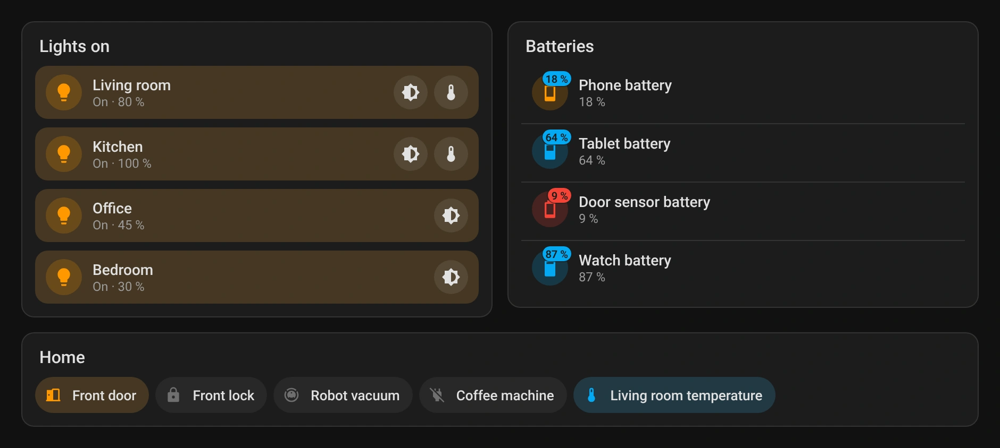
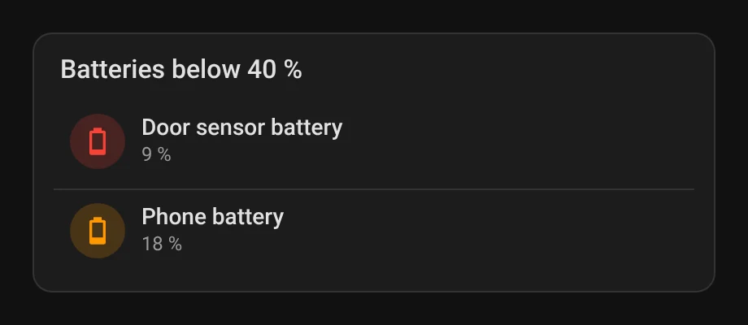
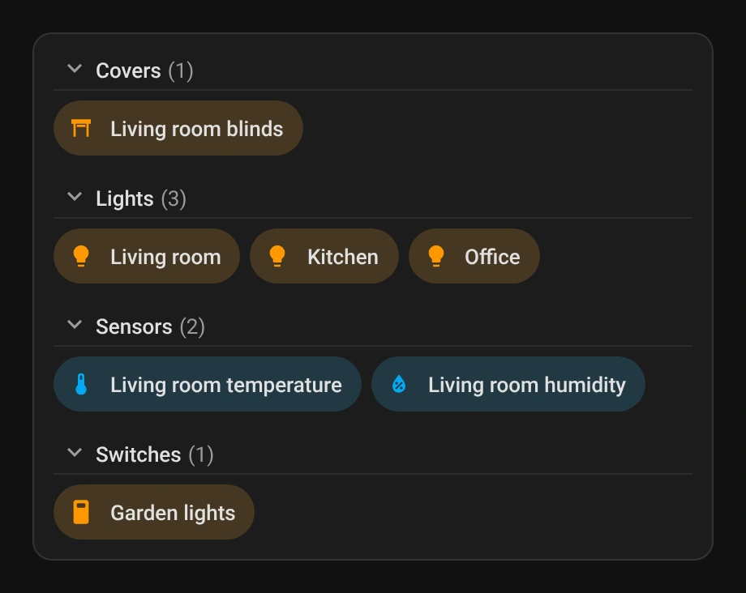
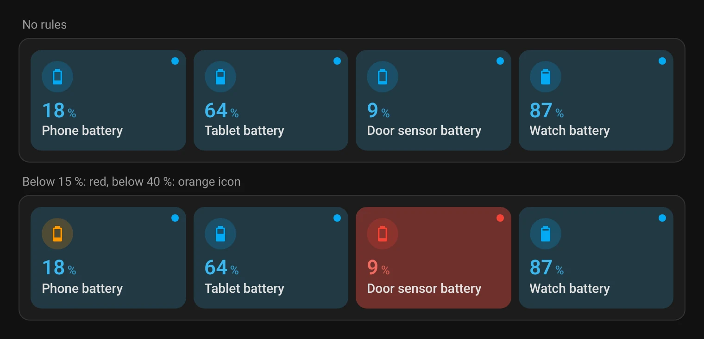
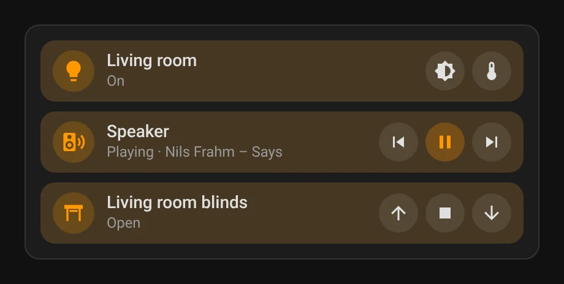

# Curio Card

A Home Assistant card for entities that change. You describe *which* entities you want with rules, for example every battery below 20 %, and the card keeps the list up to date by itself. Colours, animation and grouping can follow rules too. Everything is set up in a visual editor, so you never have to write YAML.

I made Curio Card for my own dashboards. It is a hobby project, so please tell me what breaks.



- **Dynamic lists with rules:** pick entities by hand, or let a filter find them by domain, name, state, attribute, area, label and more. Combine rules with AND and OR, exclude what you do not want, and show an entity only when a condition holds
- **Four layouts:** chips, tiles, list and grid, with five sizes, four shapes and your choice of icon position
- **Colour and animation rules:** change the colour of the whole item, the icon or the indicator from a value, for example a battery below 20 % turning red and pulsing
- **Grouping:** group by area, device, device class, domain or state, or build your own groups with rules. Groups can be folded
- **Sections and dividers** in a manual list, and settings that apply to one entity only
- **Controls and your own buttons:** ready-made buttons, sliders and lists for lights, covers, media players and more, plus round buttons of your own that run any action
- **Status indicators:** dot, corner badge, ring, stripe, notification bubble or state text
- **Secondary information:** state, battery, brightness, media title, temperatures, signal, power and more under the name
- **Visual editor** in English and Danish, following the Home Assistant language. The card only stores what you change from the defaults

## Previews

| | |
|---|---|
|  |  |
| A filter that finds every low battery | Grouped by domain |
|  |  |
| Colour and animation rules | Buttons on lights, players and covers |

The pictures use made-up entities.

## Requirements

- Home Assistant. The card is developed and tested in Home Assistant 2026.11
- Nothing else to install. Curio Card is a single card, and you set it up in the visual editor

## Installation

### With the Marketplace (Home Assistant 2026.11 or later)

[](https://my.home-assistant.io/redirect/hacs_repository/?owner=oreskov&repository=curio-card&category=plugin)

Or do it by hand:

1. Open **Settings → Marketplace**.
2. Choose **Add from link** and enter `https://github.com/oreskov/curio-card`. Adding a repository this way requires signing in to GitHub with a device code. It only reads public information.
3. Find **Curio Card** and install it.
4. Reload the page with the cache cleared (Ctrl+F5). In the mobile app: Settings → Companion app → Clear frontend cache.

### With HACS (older Home Assistant versions)

1. Open HACS, open the menu (⋮) and choose **Custom repositories**.
2. Add `https://github.com/oreskov/curio-card` with the category **Dashboard**.
3. Download **Curio Card** and reload the page with the cache cleared.

Both place the file in `/config/www/community/curio-card/` and register the resource themselves. If you manage dashboard resources in YAML, they cannot add it for you. The install dialog then shows what to add manually, or follow the manual steps below.

### Manually

1. Copy `curio-card.js` to `/config/www/` (or a folder under it).
2. Go to **Settings → Dashboards → ⋮ (top right) → Resources → Add resource**
   - URL: `/local/curio-card.js`
   - Type: **JavaScript module**

   If the menu item is missing, turn on *Advanced mode* in your user profile.
3. Reload the page with the cache cleared.

When you update the file later, change the resource URL to for example `/local/curio-card.js?v=2`, so the browser fetches the new version.

## Add the card

Edit the dashboard, choose **Add card** and search for **Curio**. The visual editor opens. Or add a manual card with YAML:

```yaml
type: custom:curio-card
entities:
  - light.living_room
  - light.kitchen
```

You can leave the YAML alone from here: everything below is set in the editor. More about the first steps is in [Getting started](https://github.com/oreskov/curio-card/blob/main/docs/getting-started.md).

## Documentation

| Page | What it covers |
|---|---|
| [Getting started](https://github.com/oreskov/curio-card/blob/main/docs/getting-started.md) | Your first card, how the editor is organised, "Changed from default" |
| [Entities](https://github.com/oreskov/curio-card/blob/main/docs/entities.md) | Manual lists, sections and dividers, settings and buttons for one entity, the same entity twice |
| [Filter](https://github.com/oreskov/curio-card/blob/main/docs/filter.md) | Finding entities with rules: Include, Exclude and Show only if, AND and OR, fields and comparisons |
| [Layouts](https://github.com/oreskov/curio-card/blob/main/docs/layouts.md) | Tiles, chips, list and grid, columns, alignment and icon position |
| [Appearance](https://github.com/oreskov/curio-card/blob/main/docs/appearance.md) | Shape, size, colours, secondary information and the card around the items |
| [Grouping](https://github.com/oreskov/curio-card/blob/main/docs/grouping.md) | Groups by area, device, device class, domain or state, and your own groups |
| [Colour rules](https://github.com/oreskov/curio-card/blob/main/docs/colour-rules.md) | Colour and animation from a value, per card or per entity |
| [Controls and buttons](https://github.com/oreskov/curio-card/blob/main/docs/controls-and-buttons.md) | Ready-made controls and your own buttons |
| [Status indicators](https://github.com/oreskov/curio-card/blob/main/docs/status-indicators.md) | Dot, badge, ring, stripe, bubble and state text |
| [Actions](https://github.com/oreskov/curio-card/blob/main/docs/actions.md) | Tap, hold and double tap, and what Toggle does |
| [Settings reference](https://github.com/oreskov/curio-card/blob/main/docs/settings-reference.md) | Every setting with its YAML key and default |
| [Recipes](https://github.com/oreskov/curio-card/blob/main/docs/recipes.md) | Twenty ready-made cards with the steps to build them in the editor |
| [Troubleshooting](https://github.com/oreskov/curio-card/blob/main/docs/troubleshooting.md) | What to check when something does not look right |

## Known limitations

- I have only tried the climate, cover and lock controls with simulated entities so far, so they may behave differently on real devices. The device's own buttons I have tried with Music Assistant's favorite button
- I have not tried the card inside Auto Entities in my own dashboards yet
- Settings for one entity exist for entities you pick by hand, not for the ones a filter finds
- A media player that can be turned on and off, but is paused, shows its switch as off. Tapping it then turns the player off instead of playing
- A filter shows at most 100 results, unless you turn on **Show all filter results**. Entities you pick by hand are not counted

If you run into any of these, or something else, you are welcome to [open an issue](https://github.com/oreskov/curio-card/issues).

## Troubleshooting

See [Troubleshooting](https://github.com/oreskov/curio-card/blob/main/docs/troubleshooting.md) for empty cards, filters that find the wrong entities, missing buttons and slow taps.

## License

MIT. See [LICENSE](https://github.com/oreskov/curio-card/blob/main/LICENSE).
