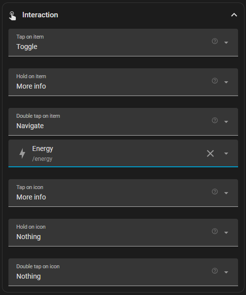

# Actions

An action is what happens when you touch the card. You choose actions in the **Interaction** section, and the choices work with the standard Home Assistant action editor, so you pick the action from a list and fill in the fields that follow.

## Where actions can be set

| Setting | What it is for | Default |
|---|---|---|
| **Tap on item** | A short tap anywhere on the item | Toggle |
| **Hold on item** | Holding your finger on the item | Nothing |
| **Double tap on item** | Two quick taps on the item | Nothing |
| **Tap on icon** | A short tap on the icon | More info |
| **Hold on icon** | Holding on the icon | Nothing |
| **Double tap on icon** | Two quick taps on the icon | Nothing |

The icon has its own actions, so the item can toggle while the icon opens the details dialog. Your own [buttons](controls-and-buttons.md#your-own-buttons) also have tap, hold and double tap. All of these can be changed for one entity under **Customise per entity** (see [Entities](entities.md#override-card-settings)).



## Action types

| Action | What it does |
|---|---|
| **Nothing** | Nothing happens. This is `none` in YAML |
| **Toggle** | Switches the entity on or off. See below for what "toggle" means for each type |
| **More info** | Opens the details dialog of the entity |
| **Navigate** | Goes to another dashboard or view. Fill in the path, for example `/lovelace/kitchen` |
| **Open URL** | Opens a web address in a new tab |
| **Perform action** | Calls a Home Assistant action (a service), with the data and target you choose |
| **Call service** | The older name for Perform action. Existing cards keep working |
| **Fire event** | Sends an event that other cards, such as browser_mod, can listen for |

### What Toggle does

| Entity | Toggle does |
|---|---|
| Light, switch, fan, input_boolean, humidifier, automation, group, siren, valve, remote | Turns it on or off |
| Lock | Unlocks a locked lock, and locks everything else |
| Cover | Opens or closes it |
| Button, input_button | Presses it |
| Scene, script | Runs it |
| Media player | Turns it on or off if it can do both. Otherwise it plays or pauses |
| Anything that cannot be toggled (sensors, climate, vacuum …) | Opens the details dialog instead |

An entity that is not found does nothing. An unavailable entity opens the details dialog instead of being toggled.

### Perform action without a target

An action on an item (tap, hold or double tap on the item or icon) is sent exactly as you set it, so choose a target. On your own **buttons** it is different: an action without a target is sent to the item's own entity, which lets one button work on every item in a list.

Home Assistant's action editor writes an empty target (`target: {}`) when you pick an action. On your own buttons the card treats a completely empty target as "no target", but only when Home Assistant says that the service accepts a target (like `light.turn_on`). A service without a target, such as `notify.*`, or a service the card does not know, is sent exactly as you set it. Anything inside the target (an area, an entity, even an empty list) is left alone, and so is an action that already has an `entity_id` in its data. Tapping the item or its icon is not affected: there you set the target yourself, or use `current`.

### Use the item's own entity with `current`

Some actions need the entity as a value, for example a script that takes the player as a field. Write `current` as the value, and the card replaces it with the entity of the item the action runs on. This way one button works on every item.

```yaml
buttons:
  - icon: mdi:playlist-music
    name: Jazz
    tap_action:
      action: perform-action
      perform_action: script.deezer_genre_flows_controller
      data:
        entity_id: current
        flow: Jazz
        volume: 0.3
```

On the item `media_player.kitchen` the script receives `entity_id: media_player.kitchen`, and on `media_player.living_room` it receives that one. Use the field name the script itself uses, for example `entity_id` if the script has a field called that.

- It works in **data** and in **target**, also inside lists, for every action on the card (tap, hold, double tap, on items, icons and buttons)
- Only a value that is exactly `current` is replaced. A text that merely contains the word, like `current song`, is left alone, and so is `Current`
- Your configuration is not changed, so the same action can be used on many items
- For the **target**, you do not need YAML: under an action of the type **Perform action**, switch on **Target the item's own entity (current)**. It appears under item and icon actions, under an entity's own actions and under your own buttons. Switched on, the target becomes `current`. Switched off, it is removed again, and other targets you set (an area, for example) are kept
- Home Assistant's own target picker only knows real entities, so it shows **Entity not found** next to `current`. That is expected, and the editor says so under the switch
- For a value in the action's **data**, the editor also offers a switch, for each field of the action that is an entity picker (the editor reads this from Home Assistant's list of actions, so a script's fields are included). It is named after the field, for example **Set «Entity» to the item's own entity (current)**. Switched on, the field is set to `current`. Switched off, only that field is removed, and the other fields stay. A field that is not an entity picker, for example a plain text field, has no switch: write `current` as its value in the action's YAML (the **Edit in YAML** menu of the action) or in the card's code editor
- The switches for target and data are independent. A service such as `light.turn_on` only needs the target, and a script like the one above only needs its data field, but both can be on at the same time
- A data field that accepts several entities gets `current` as plain text, not as a list. If the field is already a list that contains `current`, the switch removes only `current` from it

## Tap, hold and double tap

- A **hold** is 0.5 seconds. Moving the finger more than a few pixels cancels it
- A **double tap** is two taps within 0.25 seconds
- If double tap is **Nothing**, a tap runs at once. If a double tap action is set, a single tap waits 0.25 seconds to see whether a second tap follows, so it feels slightly slower
- When hold is set, the menu that a long press opens in some browsers is suppressed
- With the keyboard, Enter or Space runs the tap action

## In YAML

```yaml
type: custom:curio-card
tap_action:
  action: toggle
hold_action:
  action: more-info
double_tap_action:
  action: navigate
  navigation_path: /lovelace/lights
icon_tap_action:
  action: perform-action
  perform_action: light.turn_off
  target:
    entity_id: light.living_room
```
