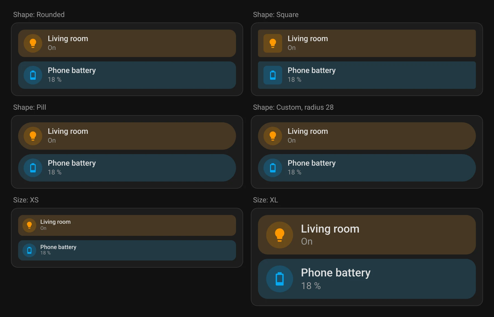
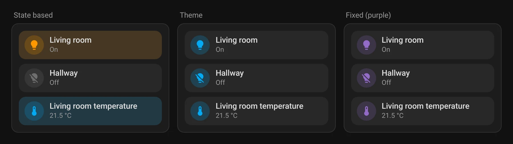
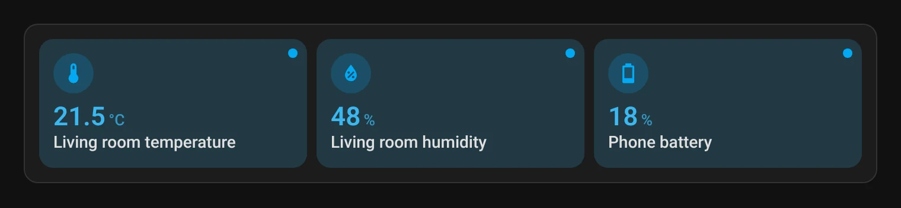
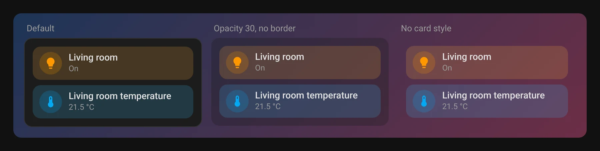

# Appearance

The **Appearance** section controls how an item looks: shape and size, colours, icon and name, the information under the name, and the card around the items. Every setting here applies to the whole card. A few of them can be changed for one entity only (see [Entities](entities.md#override-card-settings)).



## Items

| Setting | Choices | What it does |
|---|---|---|
| **Shape** | Rounded, Square, Pill, Custom | The corners of the items. Pill is the default for chips and Rounded for the others |
| **Custom radius** | 0 to 50 px | The corner radius when Shape is Custom |
| **Size** | XS, S, M, L, XL | Scales the items and their text. M is the default |
| **Item background** | Filled, Outline only, Transparent | The background behind each item. List defaults to Transparent and the others to Filled |
| **Long text** | Scroll, Truncate with … | What happens to text that does not fit. Not available in chips, where text does not scroll |

## Colours

**Colours** decides where an item gets its colour from.

| Choice | What happens |
|---|---|
| **State based** | Active items (on, open, playing) are coloured and inactive ones are dimmed. This is the default |
| **Theme** | Every item uses the colour of the theme |
| **Fixed** | Every item uses **Fixed colour**. A single entity can have its own fixed colour as an override |

An active light uses the colour it shines in. Other active entities use the active colour of the theme for their domain, inactive ones the inactive colour of the theme, and unavailable ones the unavailable colour. An entity that is not found uses the warning colour. For colours that depend on a value, such as a battery below 20 %, use [Colour rules](colour-rules.md).



## Icon and name

| Setting | What it does |
|---|---|
| **Show icon** | Shows the icon on the item |
| **Icon size** | Automatic (follows the size of the item), S, M, L or XL. Only when the icon is shown |
| **Show name** | Shows the name on the item |

You can give a single entity its own name and icon under [Entities](entities.md#name-and-icon).

## Secondary information

The line under the name. The choices are grouped by type, and only the types in the card are listed (turn on **Show all types** to see the rest). You can choose several, and they are shown on one line separated by **·**. They always appear in the order of the table below, whatever order you pick them in. Each item only shows the ones it has. The default is State, except for chips, which show none.

| Choice | Shows |
|---|---|
| **State** | The state, in your language |
| **Brightness**, **Kelvin** | Light brightness, and colour temperature in Kelvin |
| **Cover: position**, **Cover: tilt** | How open a cover is, and its tilt |
| **Fan: speed** | The speed of a fan |
| **Climate: current → target**, **Climate: what it is doing now** | Temperatures, and heating, cooling, idle and so on |
| **Vacuum: suction power** | The suction power setting |
| **Battery** | The battery level, from the entity's `battery_level` attribute, or from the entity itself when it is a battery sensor |
| **Media player: artist and title**, **Media player: volume** | What is playing, and the volume |
| **Device's sensor: signal, power, energy, temperature, humidity** | A sensor that belongs to the same device as the entity |
| **Last changed** | How long ago the state changed, for example "5 minutes ago" |
| **Attribute** | An attribute of your choice. Fill in **Attribute name** |

Choose **None** for no secondary line.

**Big value** (tiles and grid) shows the first piece of secondary information large and in the colour of the item, for example `18 %` instead of a small line of text.



## The card around the items

| Setting | What it does |
|---|---|
| **No card style** | Removes the card background, border and shadow, so the items float on the dashboard |
| **Card opacity** | 0 to 100 %. 100 is as the theme, 0 is fully transparent. The items are not affected |
| **Hide border** | Removes the border of the card, whatever the theme uses |
| **Hide shadow** | Removes the shadow, if the theme has one |
| **Card corners** | Theme, Square or Custom |
| **Card corner radius** | 0 to 50 px. Only with Custom |

When **No card style** is on, the other card settings are hidden, because there is no card left to change.



## Switch

**Show switch** adds an on/off switch to entities that can be switched. It is available in List and Tiles and is on by default in List. A single entity can turn it on or off for itself.

## In YAML

```yaml
type: custom:curio-card
shape: pill
size: s
color_mode: theme
secondary_info:
  - state
  - last_changed
card_opacity: 40
hide_shadow: true
```
