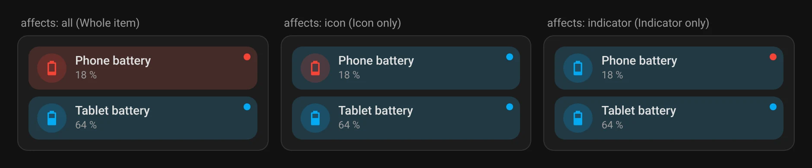
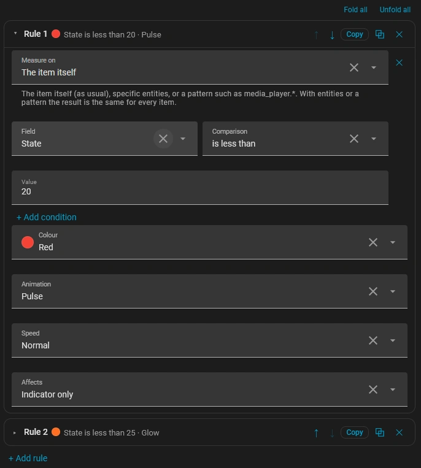
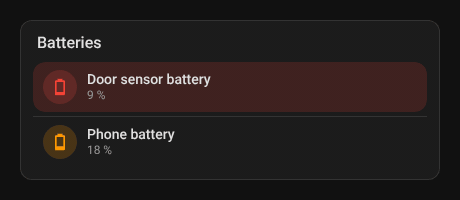

# Colour rules

Colour rules change the colour of an item, and can make it animate, from a value. A battery below 20 % turns red and pulses, a window that is open turns orange, a cover that is closed stays calm. They are in the **Colours and animation** section.



## How the rules work

- A rule is built like a rule in the [filter](filter.md#rules-and-conditions): one or more conditions, and all of them must match
- The rules are checked from the top, and **the first rule that matches wins**. Put the most important rule first
- If no rule matches, the item looks as the card's [Colours](appearance.md#colours) setting says
- Rules for one entity (under **Entities → Customise per entity**) are checked before the rules of the card
- In the editor, each rule is folded and shows a summary (the conditions and the colour). Click a rule to open it. A rule you add opens by itself, and a rule stays open while you edit it. With two or more rules there are **Fold all** and **Unfold all** buttons. The same goes for filter rules, group rules and own buttons
- The button **⧉** on a rule duplicates it right below, which is handy when two rules differ only in a value or a colour
- Each rule also has a **Copy** button that puts it in the editor's clipboard. Wherever colour rules are listed (the card's, or any entity's), **Paste here** then adds a copy of it. The clipboard keeps the rule until you copy something else or clear it with the cross, so you can paste it several times. It is shared by all open editors on the page, so you can copy a rule from one Curio Card and paste it in another. It is emptied when the page is reloaded
- On an entity, **Copy the card's rules here** adds the card's rules to that entity. To copy an entity's rules to other entities, see [Copy to other entities](entities.md#copy-to-other-entities)
- Unfinished rules are ignored

Use **Add rule** to start a rule. Each rule has these settings after its conditions:

| Setting | Choices | What it does |
|---|---|---|
| **Colour** | Any colour | The colour to use. Leave it empty to animate without changing the colour |
| **Affects** | Whole item, Icon only, Indicator only | What is coloured. *Indicator only* changes the [status indicator](status-indicators.md) and leaves the item as it was |
| **Animation** | None, Pulse, Pulse (size), Blink, Glow, Rotation (icon only) | How the item moves |
| **Speed** | Slow, Normal, Fast | How fast the animation runs |

A rule needs a colour, an animation, or both, and at least one finished condition.



### Animations



| Animation | What it does |
|---|---|
| **Pulse** | The item or icon fades gently in and out |
| **Pulse (size)** | The icon grows and shrinks a little and fades slightly |
| **Blink** | Switches sharply between visible and nearly invisible |
| **Glow** | A soft glow that grows and fades |
| **Rotation (icon only)** | The icon turns round. It is always the icon that turns, whatever *Affects* says |

With *Whole item*, the border and background of the item animate, and the icon and text stand still. (With *Pulse (size)* the icon is what moves.) Animations are switched off automatically if the device is set to reduce motion.

## Examples

| Goal | Conditions | Colour | Affects | Animation |
|---|---|---|---|---|
| Low battery | *Device class* is `battery` **and** *State* is less than `20` | Red | Whole item | Pulse, slow |
| Window open | *Device class* is `window` **and** *State* is `on` | Orange | Icon only | None |
| Something is running | *Domain* is `vacuum` **and** *State* is `cleaning` | Blue | Icon only | Rotation |
| Alarm triggered | *State* is `triggered` | Red | Whole item | Blink, fast |
| Warm room | *Attribute* `current_temperature` is greater than `24` | Orange | Indicator only | None |

Put the strict rules first. A battery that is below 10 % could come before one that is below 20 %, with a different colour for each.

## In YAML

```yaml
type: custom:curio-card
color_rules:
  - conditions:
      - field: device_class
        operator: is
        value: battery
      - field: state
        operator: lt
        value: "20"
    color: red
    affects: all
    animation: pulse
    speed: slow
```

An entity of its own has the same list under `color_rules`.
