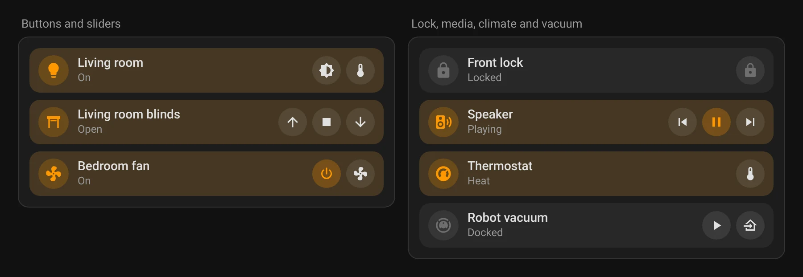
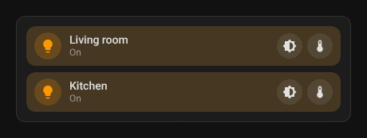
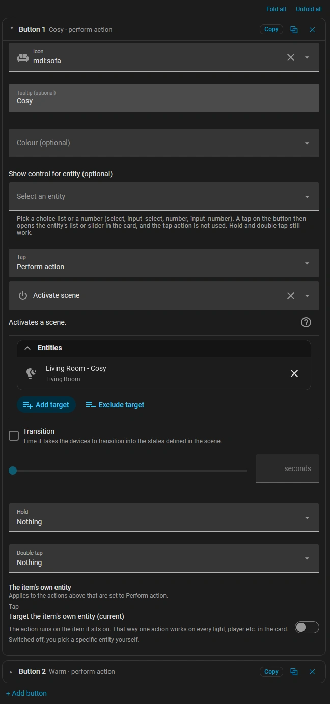

# Controls and buttons

An item can carry small round buttons next to its text, and open sliders and lists inside the item. There are two kinds, and they are set in the **Buttons** section.

| Kind | What it is | Set under |
|---|---|---|
| **Controls** | Ready-made buttons, sliders and lists for the type of entity: brightness, cover, fan, media player, lock, climate, vacuum, numbers and choices | **Buttons → Controls** |
| **Your own buttons** | Round icon buttons that run any action you choose | **Buttons → Add button** |



## Controls

Choose the controls you want under **Controls**. The list is grouped by type (Light, Cover, Fan and so on) and only shows the types that are in the card. Turn on **Show all types** to list the rest. Every item shows only the controls that its type and device can do. A light with no colour support does not get a colour control, even if you chose one. The default is no controls.

| Control | Kind | Entity |
|---|---|---|
| Light: brightness | Slider | Light |
| Light: Kelvin (colour temperature) | Slider | Light |
| Light: colour | Colour picker | Light |
| Cover: open, stop, close | Buttons | Cover |
| Cover: position, tilt | Sliders | Cover |
| Fan: turn on/off, oscillation, direction | Buttons | Fan |
| Fan: speed | Slider | Fan |
| Media player: previous, play/pause, next, mute | Buttons | Media player |
| Media player: volume | Slider | Media player |
| Lock: lock/unlock | Button | Lock |
| Climate: target temperature | Slider | Climate |
| Climate: HVAC mode, preset, fan mode | Lists | Climate |
| Vacuum: start/pause, stop, return to dock, locate | Buttons | Vacuum |
| Vacuum: suction power | List | Vacuum |
| Vacuum: clean by area | Area picker | Vacuum |
| Number: slider | Slider | `number`, `input_number` |
| Choice: list | List | `select`, `input_select` |

**Buttons** act at once. **Sliders** and **lists** unfold inside the item, and the **✕** closes them again. Each item has one open control at a time.



### Settings

| Setting | What it does |
|---|---|
| **Controls** | Which controls to show, grouped by type |
| **Show all types** | Also lists the types that are not in the card yet |
| **The device's own choices, numbers and buttons** | Also shows the select lists, numbers and buttons that belong to the same device, for example a fan's horizontal and vertical swing or a player's favorite button. Diagnostic and hidden entities are left out, and so are buttons for restart, update and configuration. An item gets at most four. Not shown in chips |
| **The device's own controls: order** | Which of them come first when there are more than four: *Buttons first* (default) or *Choices and numbers first*. Only shown when the setting above is on |
| **Device buttons: light up when pressed** | The device's own buttons light up for about a second and a half after a press (default: on). Only shown when the device's own controls are on |
| **Button size** | Automatic (follows the size of the item), S, M, L or XL. The slider gets the same height as the buttons |
| **Button colour** | One colour for all buttons (icon and a faint background). Empty is neutral. An own button can have its own colour |
| **Close control automatically after (sec.)** | A slider closes by itself after this many seconds without touch. 0 means it only closes with ✕ |

The controls always appear in the order of the table above, whatever order you pick them in.

A locked lock asks you to press twice before it unlocks. The first press changes the button's tooltip to "Press again to unlock", and a second press within three seconds unlocks it.

### What controls are not shown

- In **chips**, only buttons are shown. Sliders, lists, your own buttons and the device's own choices, numbers and buttons are left out, because a chip is too small
- An entity that is not found, or whose state is unavailable, shows no controls

### The device's own buttons

Some devices have buttons of their own, for example the *Favorite current song* button that Music Assistant creates for each player. With **The device's own choices, numbers and buttons** turned on, such a button is shown next to the item's other controls, and a press does the same as pressing it in Home Assistant (`button.press`).

- Only buttons from the same device are shown. Buttons for restart and update, and buttons that Home Assistant has marked as configuration or diagnostic, are left out, so you cannot press them by accident
- A button that is unavailable (the favorite button is, while nothing is playing) stays in place but is dimmed and cannot be pressed
- The icon is the one the entity has in Home Assistant
- An item shows at most four of the device's own controls. Buttons come first by default. Use **The device's own controls: order** to put choices and numbers first instead
- A pressed button lights up briefly, so you can see that the press was sent. A button in Home Assistant has no on/off state, so the card cannot know whether the action worked, for example that a song was added to the favorites. The light is only a confirmation of the press. Turn it off with **Device buttons: light up when pressed**. Your own buttons are not affected
- All three settings can be changed for a single entity under **Customise per entity**

```yaml
type: custom:curio-card
layout: list
controls:
  - media_prev
  - media_play_pause
  - media_next
device_controls: true
entities:
  - media_player.living_room
```

If a button does not show up, check in Home Assistant that it belongs to the same device as the player and is not marked as configuration or diagnostic.

## Your own buttons

Your own buttons are round icon buttons that can run any [action](actions.md). They sit to the right of the item's text (in the grid, below it).

1. Open **Buttons** and choose **Add button**.
2. Pick an **Icon**, and fill in **Tooltip** if you like (shown when you hover with a mouse), and a **Colour**.
3. Choose what happens on **Tap**, **Hold** and **Double tap**. Or choose an entity under **Show control for entity** (see below).



If an action calls a service without saying which entity, it is sent to the item's own entity. This means the same button works on every item in a filtered list. Home Assistant's action editor adds an empty target (`target: {}`) when you pick an action. The card treats that as "no target" too, as long as Home Assistant says that the service accepts a target (like `light.turn_on`). A service that takes no target, such as a notification, is sent exactly as you set it. To send an action somewhere else, give it a target of its own.

If you want to name the item's own entity yourself, switch on **Target the item's own entity (current)** under the action. If the service or script wants the entity as a value in its data, write `current` there, and it is replaced with the item's own entity. See [Actions](actions.md#use-the-items-own-entity-with-current).

Each button has a **⧉** button that duplicates it, and a **Copy** button that puts it in the editor's clipboard. **Paste here** under any list of buttons (the card's or an entity's) adds a copy of it. This works the same way as for [colour rules](colour-rules.md), and the clipboard is shared with them, but holds one item at a time.

An entity can have its own buttons instead of the card's. See [Entities](entities.md#own-buttons-on-this-entity). If the entity has its own list, the card's buttons are not used on that entity. An entity with an empty list has no own buttons at all. To leave the card's buttons off one entity, switch off **Use the card's buttons** in its own section (the list then starts empty).

### A button that shows an entity's control

Pick an entity under **Show control for entity**, and a tap on the button opens that entity's list or slider right in the card, the same way the controls for lights and media players do. Use it to change a choice or a number without leaving the dashboard, for example a house mode (`input_select`) or a volume level (`input_number`).

- It works for **select lists and numbers**: `select`, `input_select`, `number` and `input_number`
- The icon and the tooltip are taken from the entity, unless you fill in your own
- A tap opens the control, so the **Tap** action is not used and its field is hidden. **Hold** and **Double tap** still work
- The button is dimmed and cannot be pressed while the entity is unavailable or does not exist
- It works on the card's buttons (which every item gets, including the ones a filter finds) and on the buttons of a single entity. The entity you pick does not have to be one of the items
- **Hide all buttons** removes it, and it is not shown in chips

```yaml
type: custom:curio-card
entities:
  - light.living_room
buttons:
  - entity: input_select.house_mode
  - entity: input_number.volume
    icon: mdi:volume-high
    name: Volume
```

Want a single press instead of a list? Use an action. The button below jumps to the next choice in the list.

```yaml
buttons:
  - icon: mdi:skip-next
    name: Next mode
    tap_action:
      action: perform-action
      perform_action: input_select.select_next
      target:
        entity_id: input_select.house_mode
```

### Example: a button that turns off every light in the area

| Field | Value |
|---|---|
| Icon | `mdi:lightbulb-off` |
| Tap | Perform action: `light.turn_off`, target area `living_room` |

## Hide all buttons on one entity

Under **Customise per entity → Add override…** you find **Hide all buttons**. It removes the controls, the device's own choices, numbers and buttons, your own buttons and the on/off switch from that entity. The rest of the card is not changed.

## In YAML

```yaml
type: custom:curio-card
controls:
  - brightness
  - kelvin
button_size: m
controls_autoclose: 8
buttons:
  - icon: mdi:power
    name: Turn off
    tap_action:
      action: perform-action
      perform_action: homeassistant.turn_off
```
