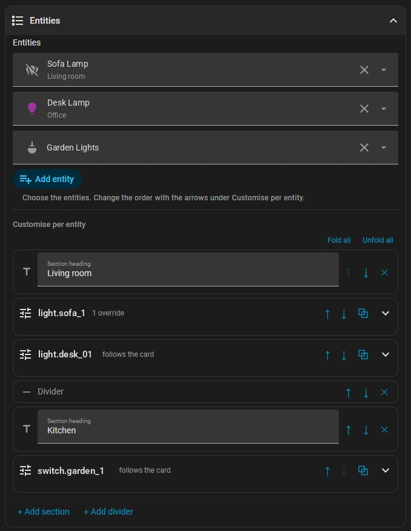
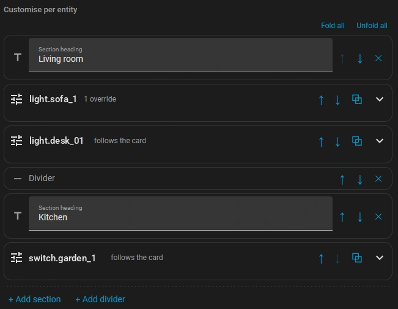
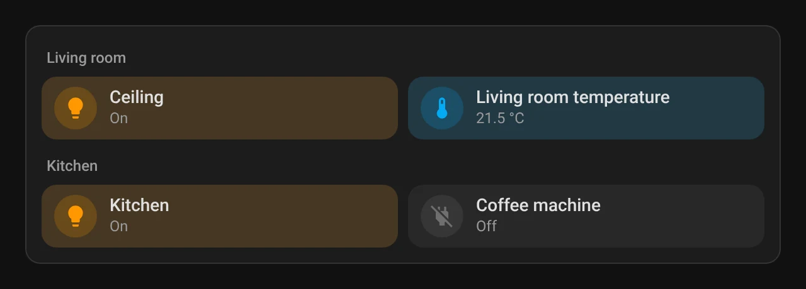
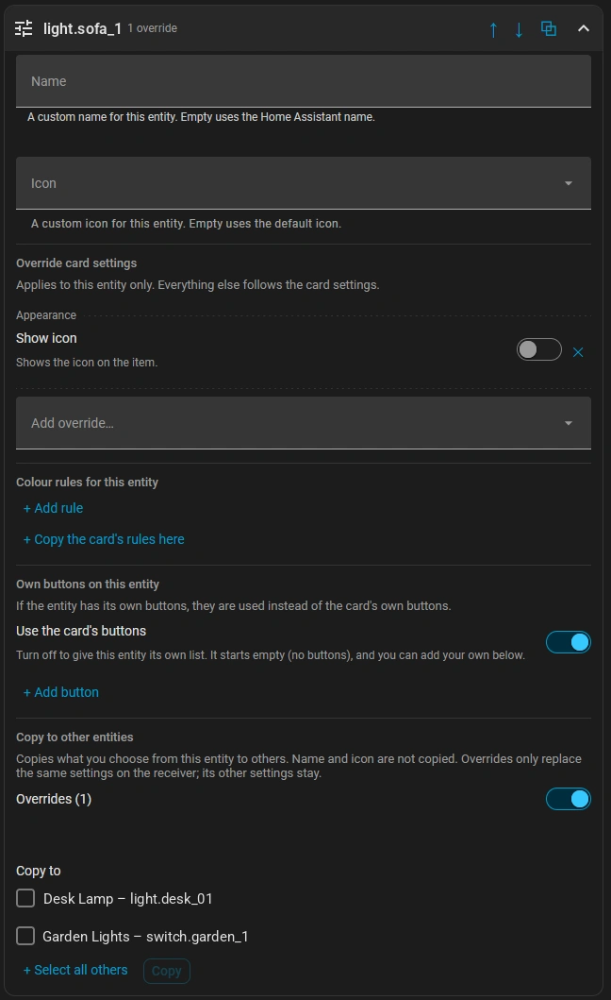

# Entities

The **Entities** section is where you pick the entities you want by hand. You can order them, split the list with headings and dividers, and give a single entity its own name, icon, settings, colour rules and buttons. To let rules find entities for you instead, see [Filter](filter.md). The two work together: your own entities come first, then the filter result.

## Pick the entities

Open **Entities** and use the entity field to add entities. Remove an entity from the same field. A card with no entities and no filter shows the text "No entities to show". You can change that text under **Layout → Text when empty**.



Below the entity field you find **Customise per entity**. It has one row for every entity, in the order they appear on the card.



### Order

Each row has **↑** and **↓** to move it one step. A row swaps places with its neighbour, whether that neighbour is an entity, a section or a divider.

### What an entity looks like when something is wrong

| Situation | What the card shows |
|---|---|
| The entity does not exist in Home Assistant | The name and "Not found" in the warning colour. It cannot be tapped |
| The entity is unavailable or unknown | The item is dimmed. Turn on **Advanced → Hide unavailable** to remove it |
| The entity is off, closed or idle | With state based colours, the item is shown in the inactive colour. Turn on **Advanced → Show only active** to remove it |

## Sections and dividers

Use **Add section** to put a heading in the list and **Add divider** to put in a thin line. Both are added at the end of the list; move them with the arrows. A section has a text field for its heading (the default is "Section") and a cross to remove it.



- A section or divider is only shown when an entity follows it. An empty section does not leave a lonely heading behind
- Sections and dividers work in every layout
- If you turn on [Grouping](grouping.md), the groups replace your sections and dividers. They are kept in the card, but not shown, while a grouping is active
- With **Also sort manual entities** (under **Filter**), the entities are sorted inside each section

## Settings for one entity

Open a row under **Customise per entity** to change that entity only. Everything else on the card still follows the card settings.

Each row is folded and shows a short summary of what is changed on that entity, for example *2 overrides · 1 rule · 3 buttons*, or *follows the card* when nothing is changed. With several entities, use **Fold all** and **Unfold all** above the list to open or close all of them at once.



### Name and icon

- **Name:** your own name for this entity. Leave it empty to use the name from Home Assistant
- **Icon:** your own icon. Leave it empty to use the default icon of the entity

### Override card settings

Choose **Add override…** to give this entity its own value for a card setting. It works in two steps: first pick a category (**Layout**, **Appearance**, **Interaction**, **Buttons** or **Status indicators**), then the setting inside it. **Hide all buttons** is its own choice in the first list. The overrides you have added are shown under small headings for their category. Switches and lists start with the value the card uses now, so nothing changes until you change it. Text and colour fields start empty and are only saved when you fill them in. Remove an override with the cross beside it, and the entity follows the card again.

The list only offers settings that make sense for this entity and for your current layout. For example, **Fixed colour** only appears when the card's colours are set to Fixed.

| Setting | What it does on this entity |
|---|---|
| Hide all buttons | Hides controls, the device's own choices, numbers and buttons, your own buttons and the switch. Other entities keep theirs |
| Fixed colour | A colour of its own, when the card's colours are set to Fixed |
| Text alignment | Where the text sits in this item: Automatic, Left, Centre or Right (see [Layouts](layouts.md#text-alignment)) |
| Show icon, Show name, Hide the device name | Turn the icon or the name on or off, or take the device's name off the start of the name |
| Secondary information, Attribute name | Which information is shown under the name |
| Show switch | The on/off switch in list and tiles |
| Tap on item, Hold on item, Double tap on item | Actions for the whole item |
| Tap on icon, Hold on icon, Double tap on icon | Actions for the icon |
| Controls, The device's own choices, numbers and buttons, The device's own controls: order | Which controls this entity has, and in which order the device's own ones come |
| Button placement | Where the row of buttons sits on this entity (see [Controls and buttons](controls-and-buttons.md#where-the-buttons-sit-and-in-what-order)) |
| Status indicator, Bubble shows the text, Position | The status marker |

Only the controls and details that fit the type of the entity are offered. A light is offered brightness and Kelvin, a sensor is offered battery, and so on.

### Colour rules for this entity

Rules that change the colour or animate this entity only. They are checked before the card's own colour rules, and the first rule that matches wins. See [Colour rules](colour-rules.md). **Copy the card's rules here** adds a copy of the card's colour rules to this entity, ready to adjust.

### Own buttons on this entity

Round buttons that run an action or show the control of a select list or number, for this entity only. If an entity has its own buttons, they are used instead of the card's own buttons. This is not shown in the chips layout, where own buttons are not displayed. See [Controls and buttons](controls-and-buttons.md).

Under the heading you find **Use the card's buttons**, which is on by default:

- **On:** the entity shows the card's buttons, like every other entity
- **Off:** the entity gets its own list. It starts empty, so the entity shows **no buttons** while everything else (controls, the switch and so on) stays. Add buttons of your own below, and they are the only ones shown on that entity
- **Copy the card's buttons here** (shown when the list is on its own and the card has buttons) adds a copy of the card's buttons to the entity's list. Delete the ones you do not want and keep the rest, for example to leave out one of several buttons on one entity
- If you switch **Use the card's buttons** on while the entity has its own buttons, they are removed. An **Undo: restore the N deleted buttons** button (with the number of buttons) then appears beside it and puts them back, for as long as the editor is open
- Removing the last button of the entity's own list leaves it empty. Switch **Use the card's buttons** back on to return to the card's buttons

In YAML an empty list does the same: `buttons: []` means no buttons on that entity.

The order of an entity's buttons, including the device's own controls one by one, is set under **Order of the buttons** in the same panel. See [Controls and buttons](controls-and-buttons.md#where-the-buttons-sit-and-in-what-order).

```yaml
entities:
  - media_player.living_room
  - entity: media_player.bathroom
    buttons: []
```

### Copy to other entities

At the bottom of an entity's panel, **Copy to other entities** copies what you have set up on this entity to others, so several entities can work the same way without building it again. It only appears when there is more than one entity, and it only offers what this entity has.

1. Tick what to copy: **Overrides**, **Colour rules** and **Buttons**. The number beside each says how many there are
2. Choose the entities to copy to, or press **Select all others**
3. Choose what happens to the receiver's own rules and buttons: **Replace the receiver's own** or **Add after the receiver's own**
4. Press **Copy**. All the chosen entities are changed in one step

Good to know:

- To copy a single colour rule or button instead of everything, use **Copy** and **Paste here** on the rule or button. See [Colour rules](colour-rules.md)
- Overrides only replace the same settings on the receiver. Its other overrides stay
- The name and icon are not copied, since they are different for every entity
- The receiver gets a real copy. Changing it afterwards does not change the entity you copied from
- A receiver that follows the card's buttons and gets buttons with **Add** ends up with only the copied buttons. Use **Replace** or the checkbox *Use the card's buttons* if you want it differently
- Nothing is undone automatically. The change is saved like any other edit, and you can see it in YAML

## The same entity more than once

You can show the same entity several times, for example once in each of two sections. Every occurrence has its own settings. In **Customise per entity** the second occurrence is called `light.living_room (2)`.

Home Assistant's entity field normally lets you pick an entity only once. Use **⧉** (*Add the entity again*) in a row to put a copy right after it.

## Auto Entities

When the card sits inside Auto Entities, the **Entities** and **Filter** sections are hidden, because Auto Entities supplies the list. More about that in [Coming from Auto Entities?](filter.md#coming-from-auto-entities).

You can decide this yourself under **Advanced → Data source (editor only)**:

| Value | What happens |
|---|---|
| Automatic | The sections are hidden when the card is inside Auto Entities (default) |
| Manual list | The sections are always shown |
| Auto Entities | The sections are always hidden |

## In YAML

```yaml
entities:
  - type: section
    label: Living room
  - entity: light.living_room
    name: Ceiling
    icon: mdi:ceiling-light
    show_switch: true
    tap_action:
      action: more-info
  - entity: light.living_room
    name: Ceiling (colour)
    controls:
      - color
  - type: divider
  - type: section
    label: Kitchen
  - light.kitchen
```

An entity is written as plain text when it has no settings of its own, and as an object when it has. The editor changes between the two by itself.
