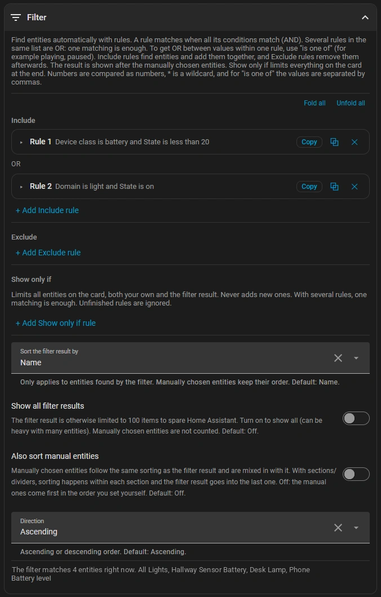
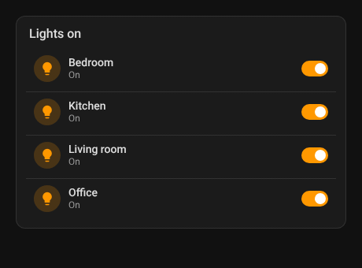
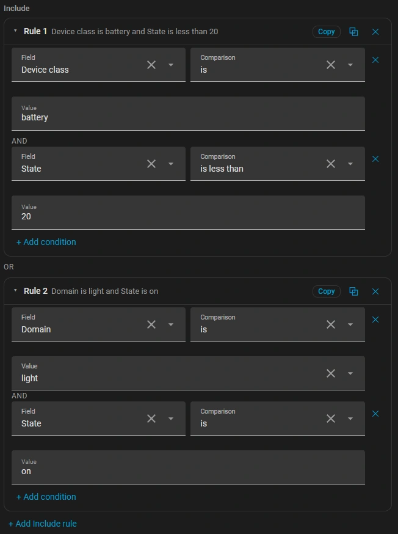

# Filter

A filter finds entities for you with rules. You say what you want ("every battery below 20 %"), and the card keeps the list up to date as the states change. Entities you pick by hand are always shown first, and the filter result follows after them.

The filter is in its own section, **Filter**, in the editor. It is not shown when the card sits inside Auto Entities.



The card follows the states live. When a light is switched off, it leaves the list at once, and it comes back when it is switched on.



## The three lists

The filter has three lists of rules.

| List | What it does |
|---|---|
| **Include** | Finds entities. All entities that match any Include rule are added together |
| **Exclude** | Removes entities again from what Include found |
| **Show only if** | Limits everything on the card, both your own entities and the filter result. It never adds entities |

The filter is only active when there is at least one complete Include rule. Without one, the editor says: *Add an Include rule to use the filter.* A **Show only if** rule works on its own, and then limits the entities you have picked by hand.

## Rules and conditions

A rule is made of one or more **conditions**. A condition has a field, a comparison and a value, for example *Domain* **is** *light*.

- **All conditions in a rule must match** (AND). The editor shows "and" between them
- **One matching rule is enough** (OR). The editor shows "or" between the rules in a list

Use **Add condition** to add another condition to a rule, and **Add Include rule**, **Add Exclude rule** or **Add Show only if rule** to start a new rule. The cross removes a condition. Removing the last condition removes the rule.



Each rule has a **⧉** button that duplicates it right below. The **Copy** button puts the rule in the editor's clipboard, and **Paste here** in any of the three lists (Include, Exclude, Show only if) adds a copy of it. The clipboard keeps the rule until you copy something else or clear it, so you can paste it more than once. It is emptied when the page is reloaded. The rules are folded in the editor and show a short summary. Click a rule to open it.

A condition without a value never matches, and a rule with an unfinished condition is ignored.

### OR between values in one rule

Rules are OR with each other, but conditions in a rule are AND. To get OR between *values* of the same field, use **is one of** and separate the values with commas:

| Field | Comparison | Value |
|---|---|---|
| State | is one of | `playing, paused, buffering` |

This matches every entity whose state is playing, paused or buffering.

## Fields

| Field | What it looks at |
|---|---|
| **Domain** | The part of the entity ID before the dot: `light`, `sensor`, `media_player` |
| **Entity ID** | The whole entity ID |
| **Name** | The friendly name of the entity |
| **State** | The state: `on`, `off`, `playing`, `21.5` |
| **Attribute** | An attribute of the entity. Fill in the attribute name too, for example `battery_level` |
| **Device class** | The device class: `battery`, `window`, `temperature` |
| **Area** | The area of the entity, or of its device. Matches the area name and the area ID |
| **Floor** | The floor of that area. Matches the floor name and the floor ID |
| **Label** | The labels on the entity. Matches the label name and the label ID |
| **Device** | The device of the entity. Matches the device name and its ID |

Area, Floor, Label and Device are only offered when Home Assistant provides the information. For Domain, Area and Floor the value field offers a list of what exists in your home, and you can still type your own value.

An attribute with a list of values matches when any of the values match.

## Comparisons

| Comparison | Matches when |
|---|---|
| **is** | The value is equal. Text ignores upper and lower case |
| **is not** | None of the values are equal |
| **is one of** | The value is equal to one of the comma separated values |
| **contains** | The value contains the text |
| **does not contain** | The value does not contain the text |
| **starts with** | The value starts with the text |
| **is less than**, **is greater than**, **is less than or equal to**, **is greater than or equal to** | The value is a number and compares like that. Only offered for **State** and **Attribute** |

Some details:

- **Numbers are compared as numbers.** `5` is less than `20`, which is not the case for text. If a value is not a number, a number comparison does not match
- **`*` is a wildcard** in **is**, **is not** and **is one of**. `light.living*` matches every light that starts with `living`. **contains** and **starts with** do not need one
- An entity with no value for the field (an attribute it does not have, a device class it does not have) matches **is not** and **does not contain**, and nothing else

## Sorting and the order on the card

Your own entities come first, in the order you set. The filter result follows after, sorted by the settings in the **Filter** section:

| Setting | Choices |
|---|---|
| **Sort the filter result by** | Name, Entity ID, State, Last changed |
| **Direction** | Ascending, Descending |
| **Also sort manual entities** | Off by default. Sorts your own entities with the same rule and mixes them with the filter result. With sections or dividers the sorting happens inside each section, and the filter result goes into the last one |

Names are sorted by the language of the card, so æ, ø and å (or ä and ö) end up in the right place. State is sorted as a number when both states are numbers. An entity that you have picked by hand and the filter also finds is shown once, in your own order.

## How many results

To protect Home Assistant, a filter shows at most **100 results**. If the filter finds more, the card shows a note: *The filter matches 142 entities, showing 100. Turn on Show all filter results to see them all.* Turn on **Show all filter results** under **Filter** to remove the limit. Entities you pick by hand are not counted.

**Advanced → Max number of items** limits the whole card (your own entities and the filter result together). 0 means no limit.

## The preview in the editor

Under the rules, the editor shows how many entities the filter matches right now and the names of the first 20 (use **Show all** for the rest). With a **Show only if** rule it also shows how many of the entities on the card pass it. The preview updates a moment after you stop typing.

Two warnings can appear:

- A rule with only `*` matches everything, and that can be heavy
- The filter matches many entities (more than 200) and the card shows at most 100

## Examples

| Goal | Rules |
|---|---|
| Every low battery | **Include:** *Device class* is `battery` **and** *State* is less than `20` |
| Every light that is on | **Include:** *Domain* is `light` **and** *State* is `on` |
| Every open window or door | **Include:** *Device class* is one of `window, door` **and** *State* is `on` |
| Everything in the living room except lamps | **Include:** *Area* is `Living room`. **Exclude:** *Name* contains `lamp` |
| Lights or switches that are on | **Include:** *Domain* is `light` **and** *State* is `on`. **Include:** *Domain* is `switch` **and** *State* is `on` |
| Media players that are playing or paused | **Include:** *Domain* is `media_player`. **Show only if:** *State* is one of `playing, paused` |
| Everything with the label *Dashboard* | **Include:** *Label* is `Dashboard` |

More setups are in [Recipes](recipes.md).

## Coming from Auto Entities?

If you already use [Auto Entities](https://github.com/thomasloven/lovelace-auto-entities), you do not have to give it up. Put Curio Card inside it as the card that shows the entities, and Auto Entities decides which ones. The card then hides its own **Entities** and **Filter** sections. You can change that under **Advanced → Data source (editor only)**.

For simple lists the filter on this page may be all you need, and then there is one card less to set up.

## In YAML

The first and the last example above in YAML:

```yaml
type: custom:curio-card
filter:
  include:
    - conditions:
        - field: device_class
          operator: is
          value: battery
        - field: state
          operator: lt
          value: "20"
```

```yaml
type: custom:curio-card
filter:
  include:
    - conditions:
        - field: domain
          operator: is
          value: media_player
  only_if:
    - conditions:
        - field: state
          operator: in
          value: playing, paused
```

The fields are `domain`, `entity_id`, `name`, `state`, `attribute` (with `attribute: <name>` on the condition), `device_class`, `area`, `floor`, `label` and `device`. The comparisons are `is`, `is_not`, `in`, `contains`, `not_contains`, `starts_with`, `lt`, `gt`, `lte` and `gte`.
