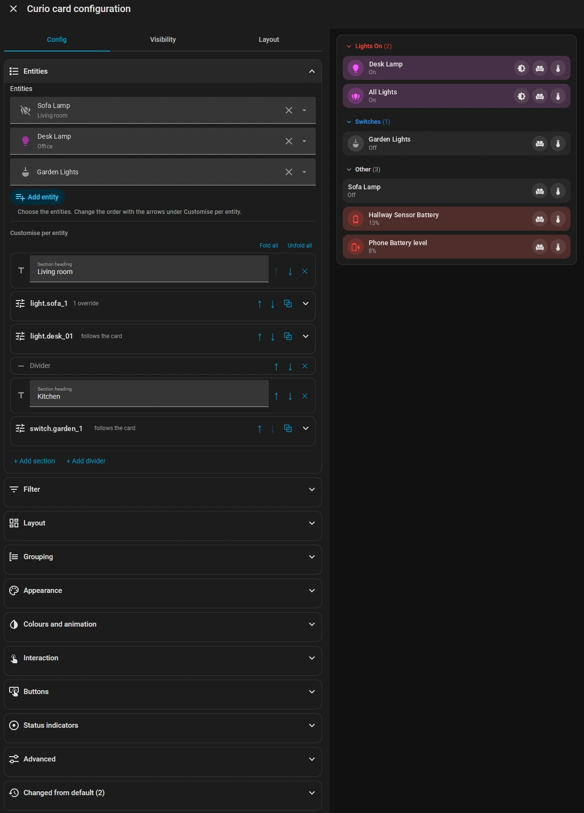
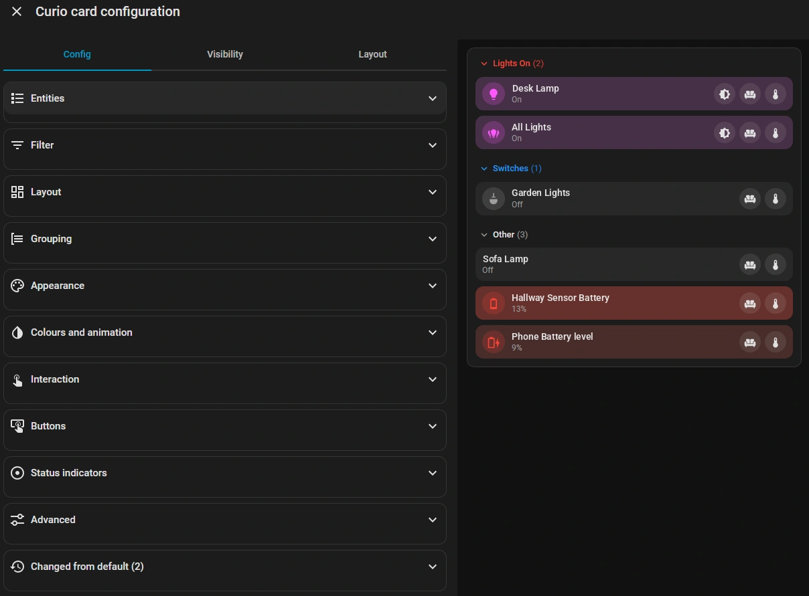
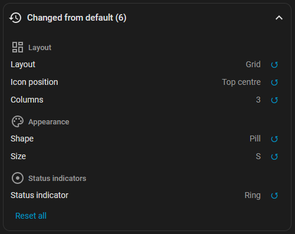

# Getting started

This page walks through a first card, shows how the editor is organised and explains how Curio Card keeps track of what you have changed.

## Your first card

1. Edit your dashboard and choose **Add card**.
2. Search for **Curio** and pick **Curio Card**. A preview appears with a few of your lights (or other entities, if you have no lights).
3. Open **Entities** and pick the entities you want. They show up in the preview as you add them.



That is a complete card. Everything else is a refinement, and every refinement has its own section in the editor.

If you prefer YAML, the same card is:

```yaml
type: custom:curio-card
entities:
  - light.living_room
  - light.kitchen
```

## The editor

The editor is a list of sections. Open the one you need; the others stay closed.

| Section | What you set there |
|---|---|
| **Entities** | Which entities to show, in which order. Sections and dividers. Settings, colour rules and buttons for one entity. See [Entities](entities.md) |
| **Filter** | Find entities with rules instead of (or as well as) picking them. See [Filter](filter.md) |
| **Layout** | Chips, tiles, list or grid. Alignment, icon and text position, columns, item width, gap, title and the text shown when the card is empty, each with size, colour, placement, style and optional animation |
| **Grouping** | Split the items into groups with a heading |
| **Appearance** | Shape, size, colours, icon, name, secondary information, and the look of the card itself (opacity, border, shadow, corners) |
| **Colours and animation** | Rules that change colour or animate from a value |
| **Interaction** | What happens when you tap, hold or double tap an item or its icon |
| **Buttons** | Controls (sliders and buttons for the entity type), your own buttons, where the buttons sit and in what order |
| **Status indicators** | A small marker that shows the status |
| **Advanced** | Show only active, hide unavailable, hide the card when empty, maximum number of items, data source |
| **Changed from default** | Everything you have changed, with a way to undo it |



Sections that do not apply are hidden. A setting also only appears when it makes sense for what you have chosen. The corner radius, for example, only appears when you have chosen custom corners.

### Help text and defaults

Every setting has a short help text under it, and the text ends with the default: "Default: Tiles." You can always see what you get if you leave a setting alone.

## Only deviations are saved

The card stores only what you have changed from the defaults. A card with the default look and two lights is just:

```yaml
type: custom:curio-card
entities:
  - light.living_room
  - light.kitchen
```

If you change something and then change it back to the default, the line disappears again.

Defaults depend on the layout. For example, chips are pill shaped and show no secondary information, while tiles are rounded and show the state. The editor knows this, so choosing a different layout does not leave odd values behind.

### Changed from default

The last section of the editor, **Changed from default**, lists every setting you have changed, grouped by section and with its current value. Use **↺** to put one setting back to its default, or **Reset all** to put every setting back. **Reset all** asks for confirmation first, and it does not touch your entities, filter, colour rules, groups or buttons.



## Language

The editor and the texts on the card follow the Home Assistant language. Danish is used when Home Assistant is set to Danish, and English for every other language. A text that is missing in one language falls back to English.

## Next steps

- [Entities](entities.md): pick entities, add sections and dividers, tailor a single entity
- [Filter](filter.md): let rules find the entities for you. Already use Auto Entities? See [Coming from Auto Entities?](filter.md#coming-from-auto-entities)
