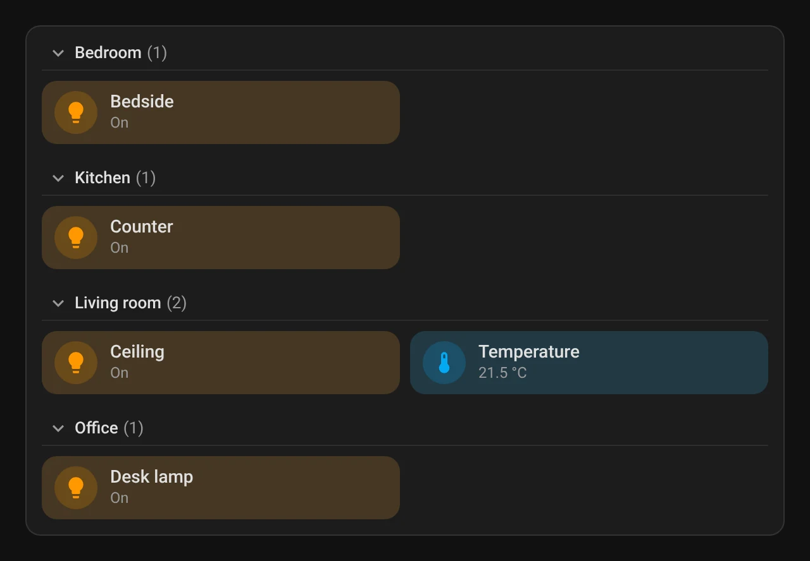
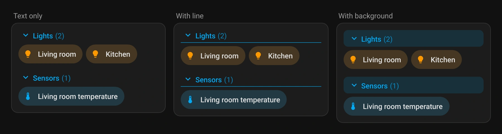
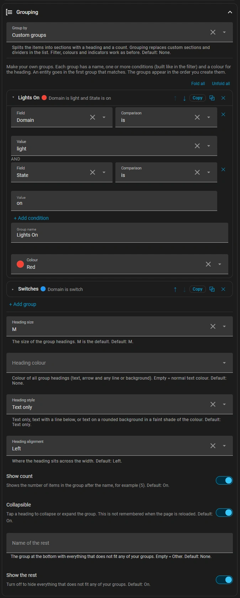

# Grouping

Grouping splits the items into groups, each with a heading and a count. It is in the **Grouping** section, under **Group by**.



## Group by

| Choice | Groups by | Order of the groups |
|---|---|---|
| **None** | No groups (default) | |
| **Area** | The area of the entity, or of its device | By name |
| **Device** | The device of the entity | By name |
| **Device class** | The device class (battery, window, temperature …) | By name |
| **Domain** | The domain (Light, Sensor, Media player …) | By name |
| **State** | Active, Inactive and Unavailable | In that order |
| **Custom groups** | Groups you make yourself with rules | The order you made them |

Entities that do not belong to any group are collected last in a group of their own: *No area*, *No device*, *No device class*. For *Custom groups* it is called *Other*, and you can rename or hide it (see below).

Grouping works on everything that is on the card: your own entities and the result of the filter. Filter, colours and indicators work the same with and without groups.

Grouping replaces your own [sections and dividers](entities.md#sections-and-dividers). They are kept in the card and come back if you set Group by to None.

## Heading settings

These settings appear when Group by is not None.

| Setting | What it does |
|---|---|
| **Heading size** | S, M, L or XL |
| **Heading colour** | One colour for all headings (text, arrow and any line or background). Empty is the normal text colour |
| **Heading style** | Text only, With line, or With background (a faint shade of the colour) |
| **Heading alignment** | Left, Centre or Right |
| **Show count** | Shows the number of items after the name, for example (5) |
| **Collapsible** | Tap a heading to fold or unfold the group. On by default. The fold is not remembered when the page is reloaded |



## Custom groups

With **Custom groups** you decide the groups yourself.

1. Set **Group by** to **Custom groups**.
2. Choose **Add group**. Add one or more conditions, built in the same way as in the [filter](filter.md#rules-and-conditions). All conditions in a group must match, and a condition can look at [other entities](filter.md#testing-other-entities).
3. Give the group a **Group name** and a heading **Colour** under its conditions.
4. Add more groups. An entity goes into the **first group that matches**, so put the narrow groups first.



Two more settings appear for custom groups:

| Setting | What it does |
|---|---|
| **Name of the rest** | The name of the last group with everything that does not match a group. Empty is *Other* |
| **Show the rest** | Turn off to hide everything that does not match a group |

A group with an unfinished condition is ignored, and a group that no entity matches is not shown. A heading colour on a group overrides the common **Heading colour**.

### Example: sort by what needs attention

| Group | Conditions |
|---|---|
| Open | *Device class* is one of `door, window` **and** *State* is `on` |
| Low battery | *Device class* is `battery` **and** *State* is less than `20` |
| Lights on | *Domain* is `light` **and** *State* is `on` |

Set **Show the rest** to off, and the card only shows the entities that need attention.

Group rules can be duplicated with **⧉**, and copied with **Copy** and pasted with **Paste here** in the list of custom groups, in the same way as [colour rules](colour-rules.md).

## In YAML

```yaml
type: custom:curio-card
group_by: custom
group_style: line
group_rest_show: false
group_rules:
  - name: Open
    color: "#e53935"
    conditions:
      - field: device_class
        operator: in
        value: door, window
      - field: state
        operator: is
        value: "on"
```
