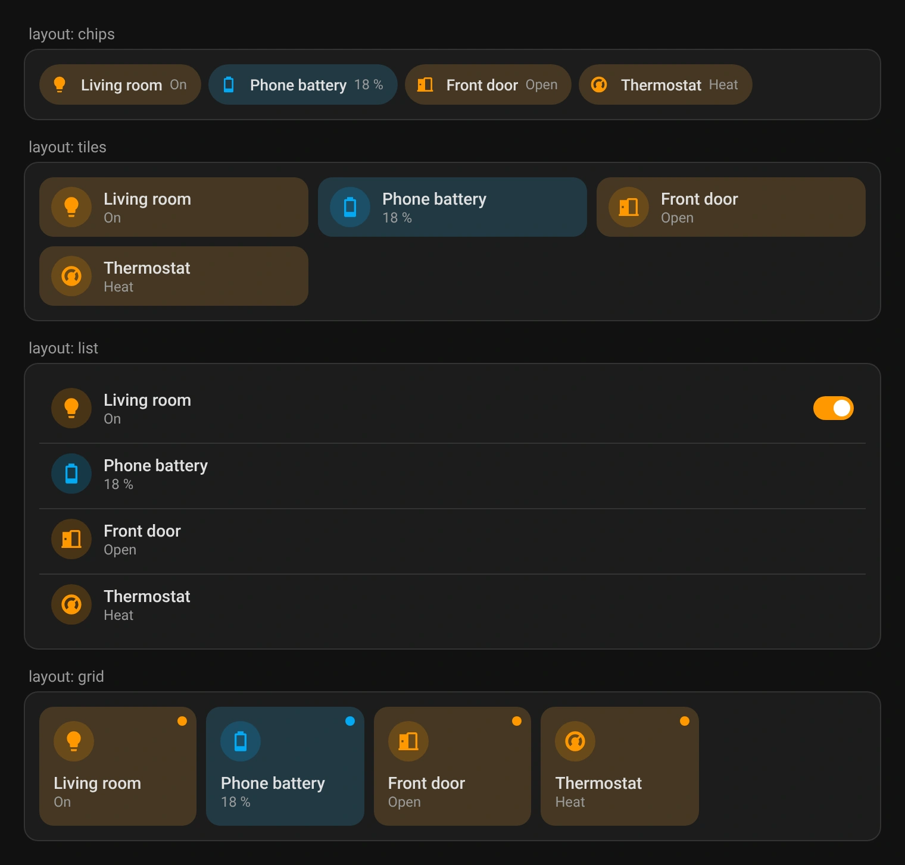
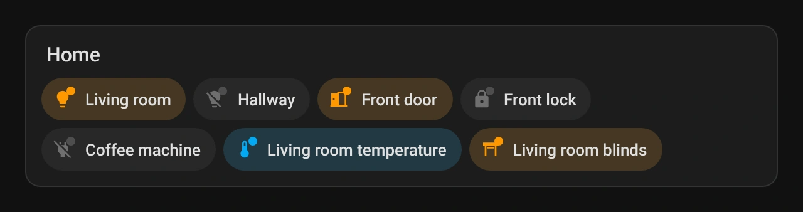
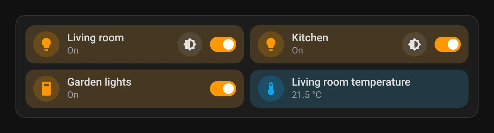
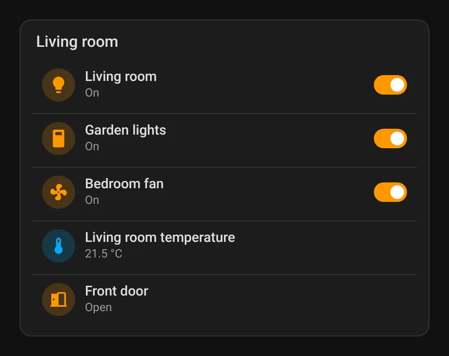
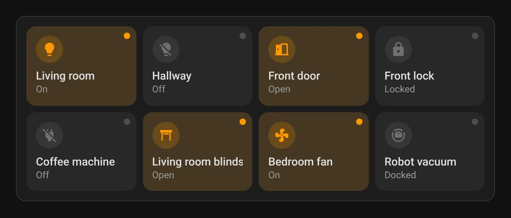

# Layouts

A layout decides how the entities are laid out on the card. You choose it in **Layout → Layout**. All four layouts show the same entities and follow the same rules for filters, colours, groups and indicators. They differ in shape and in what room they leave for controls.



| Layout | Made for | Defaults that differ from the others |
|---|---|---|
| **Tiles** | The general case. A rounded item with icon, name and one line of secondary information | Rounded corners, state as secondary information. This is the default layout |
| **Chips** | Many small entities in little space | Pill shape, no secondary information, gap 6 px |
| **List** | A narrow card, or a list you read from top to bottom | Transparent item background, the switch is shown, gap 4 px |
| **Grid** | Square items with the icon on top, like a keypad | Icon on top, a dot as status indicator |

## Settings in the Layout section

| Setting | What it does | Available in |
|---|---|---|
| **Layout** | Tiles, Chips, List or Grid | All |
| **Alignment** | How the items are placed across the width: Fill width, Left, Centred, Right, or space between. *Fill width* stretches them out | Chips, Tiles, Grid |
| **Icon position** | Where the icon sits in the item | All, with different choices (see below) |
| **Columns** | A fixed number of columns, 1 to 8. 0 chooses automatically from the width | Tiles, Grid |
| **Item width** | The minimum width of an item in pixels, when Columns is 0. 0 is automatic and leaves room for buttons | Tiles, Grid |
| **Gap** | The distance between the items in pixels (0 to 32) | All |
| **Title** | A heading above the card. Empty means no heading | All |
| **Text when empty** | What the card says when there is nothing to show. Empty uses the default text | All |

Settings that do not apply to the layout you chose are hidden. **Item width** is also hidden as soon as you set a fixed number of columns, because the columns decide the width.

### Icon position

| Layout | Choices |
|---|---|
| Chips and List | Left, Right |
| Tiles | Left, Top left, Right |
| Grid | Top left, Top centre, Top right |

If you change layout and the chosen position does not exist in the new one, the card uses the nearest one.

## Chips

Chips are the smallest layout and are meant for many entities in a row. Because a chip is small, the controls are fewer than in the other layouts:

- Only buttons that press at once are shown (open and close a cover, play and pause, and so on)
- Sliders and lists are not shown
- Your own buttons and **The device's own choices, numbers and buttons** are not shown
- Long names do not scroll



## Tiles

Tiles show icon, name and secondary information, and have room for a switch and a row of controls. With **Show switch** on, an on/off switch is placed at the end of the tile. See [Controls and buttons](controls-and-buttons.md).



## List

A list uses the full width and shows one entity per row, which is good in a narrow column. The background of each row is transparent and an on/off switch is shown for every entity that can be switched.



## Grid

A grid makes square items with the icon on top. Set **Columns** to the number you want, or leave it at 0 and the card fits as many items as the width allows, each at least **Item width** wide. A small dot in the corner shows the status. Change it under [Status indicators](status-indicators.md).



## Long names

In Tiles, List and Grid, **Appearance → Long text** decides what happens when a name or secondary information does not fit: it scrolls slowly back and forth (only when it needs to), or it is cut off with "…". See [Appearance](appearance.md).

## In YAML

```yaml
type: custom:curio-card
layout: grid
columns: 4
icon_position: top_center
gap: 12
title: Doors and windows
```
