# Recipes

Ready-made cards to copy from. Each recipe has a picture, the YAML, and the steps to build it in the editor. You never need the YAML: the steps do the same thing. Change the entity names to your own.

Several recipes use **Hide the card when empty**. Home Assistant keeps a place open for a hidden card, so a gap can remain on the dashboard (see [Troubleshooting](troubleshooting.md#the-card-is-empty)).

**Finding entities**

- [Lights that are on](#lights-that-are-on)
- [Low batteries, red and pulsing](#low-batteries-red-and-pulsing)
- [Open doors and windows](#open-doors-and-windows)
- [A room without its lamps](#a-room-without-its-lamps)
- [Your own entities, but only when the battery is low](#your-own-entities-but-only-when-the-battery-is-low)
- [Only while the vacuum is cleaning](#only-while-the-vacuum-is-cleaning)
- [Media players that are playing](#media-players-that-are-playing)
- [A selector that only shows while a player is on](#a-selector-that-only-shows-while-a-player-is-on)

**Layout, grouping and colour**

- [Rooms with headings](#rooms-with-headings)
- [Needs attention, sorted into groups](#needs-attention-sorted-into-groups)
- [Grouped by state](#grouped-by-state)
- [A keypad of scenes](#a-keypad-of-scenes)
- [Big numbers](#big-numbers)
- [IP addresses and other text values](#ip-addresses-and-other-text-values)
- [Chips with notification bubbles](#chips-with-notification-bubbles)
- [A different colour rule for one entity](#a-different-colour-rule-for-one-entity)
- [Signal and power from the device's sensors](#signal-and-power-from-the-devices-sensors)

**Controls**

- [Lights with brightness and a scene button](#lights-with-brightness-and-a-scene-button)
- [Buttons in your own place and order](#buttons-in-your-own-place-and-order)
- [Blinds and a fan](#blinds-and-a-fan)
- [A lock, a number and a choice list](#a-lock-a-number-and-a-choice-list)
- [Thermostats](#thermostats)
- [A robot vacuum](#a-robot-vacuum)
- [A fan with the device's own choices](#a-fan-with-the-devices-own-choices)

## Finding entities

### Lights that are on

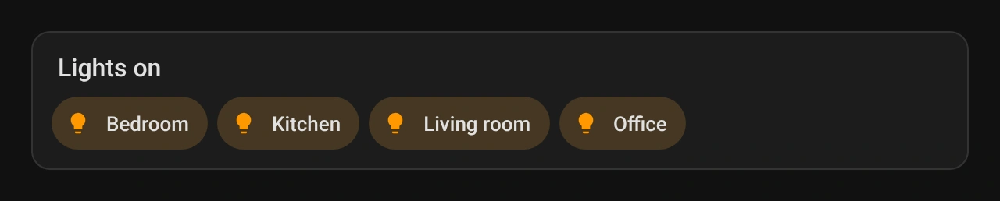

Small chips with every light that is on. The card disappears when none are.

```yaml
type: custom:curio-card
layout: chips
title: Lights on
hide_when_empty: true
filter:
  include:
    - conditions:
        - field: domain
          operator: is
          value: light
        - field: state
          operator: is
          value: "on"
```

**In the editor**

1. **Layout → Layout:** Chips. **Title:** *Lights on*.
2. **Filter → Add Include rule.** Condition 1: *Domain* **is** `light`. **Add condition**, then *State* **is** `on`.
3. **Advanced → Hide the card when empty:** on.

### Low batteries, red and pulsing

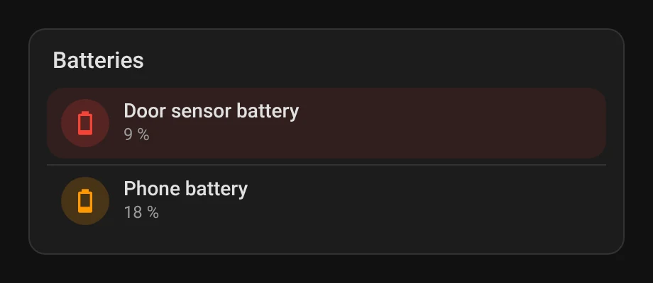

Every battery below 40 %, the lowest first. Below 15 % the item is red and pulses, below 40 % the icon is orange.

```yaml
type: custom:curio-card
layout: list
title: Batteries
hide_when_empty: true
sort_by: state
secondary_info:
  - state
filter:
  include:
    - conditions:
        - field: device_class
          operator: is
          value: battery
        - field: state
          operator: lt
          value: "40"
color_rules:
  - conditions:
      - field: state
        operator: lt
        value: "15"
    color: red
    animation: pulse
    speed: slow
  - conditions:
      - field: state
        operator: lt
        value: "40"
    color: orange
    affects: icon
```

**In the editor**

1. **Layout → Layout:** List. **Title:** *Batteries*.
2. **Filter → Add Include rule:** *Device class* **is** `battery`, and *State* **is less than** `40`.
3. **Filter → Sort the filter result by:** State, **Direction:** Ascending.
4. **Colours and animation → Add rule:** *State* **is less than** `15`, **Colour** red, **Animation** Pulse, **Speed** Slow.
5. **Add rule** again: *State* **is less than** `40`, **Colour** orange, **Affects** Icon only. The rules are checked from the top, so keep the strict one first.
6. **Advanced → Hide the card when empty:** on.

### Open doors and windows

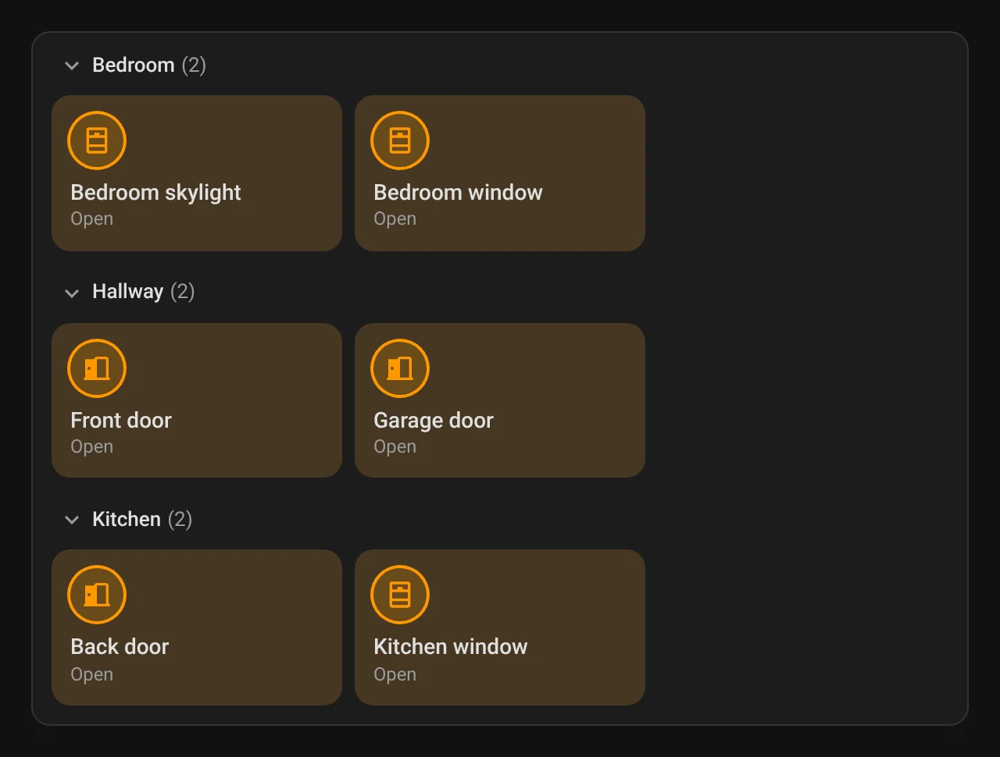

A grid with a ring around the icon, showing only what is open. Group them by area.

```yaml
type: custom:curio-card
layout: grid
columns: 3
indicator: ring
group_by: area
hide_when_empty: true
filter:
  include:
    - conditions:
        - field: device_class
          operator: in
          value: door, window
        - field: state
          operator: is
          value: "on"
```

**In the editor**

1. **Layout → Layout:** Grid, **Columns:** 3.
2. **Filter → Add Include rule:** *Device class* **is one of** `door, window` and *State* **is** `on`.
3. **Status indicators → Status indicator:** Ring.
4. **Grouping → Group by:** Area.

### A room without its lamps

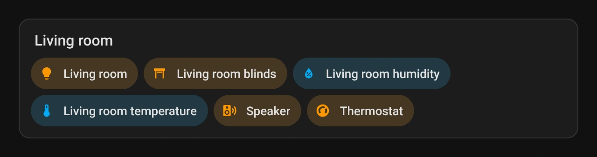

Everything in an area, except what you do not want. Here every entity in the living room, except the ones with "lamp" in the name.

```yaml
type: custom:curio-card
layout: chips
title: Living room
filter:
  include:
    - conditions:
        - field: area
          operator: is
          value: Living room
  exclude:
    - conditions:
        - field: name
          operator: contains
          value: lamp
```

**In the editor**

1. **Layout → Layout:** Chips. **Title:** *Living room*.
2. **Filter → Add Include rule:** *Area* **is** `Living room` (pick it from the list).
3. **Filter → Add Exclude rule:** *Name* **contains** `lamp`.

### Your own entities, but only when the battery is low

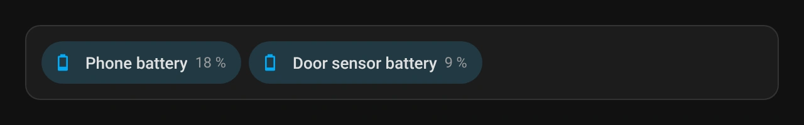

You pick the entities by hand, and **Show only if** hides the ones that are fine. No Include rule is needed, and new low batteries do not appear unless you pick them.

```yaml
type: custom:curio-card
layout: chips
hide_when_empty: true
secondary_info:
  - state
entities:
  - sensor.phone_battery
  - sensor.tablet_battery
  - sensor.door_sensor_battery
  - sensor.watch_battery
filter:
  only_if:
    - conditions:
        - field: state
          operator: lt
          value: "20"
```

**In the editor**

1. **Entities:** pick the batteries.
2. **Filter → Add Show only if rule:** *State* **is less than** `20`.
3. **Appearance → Secondary information:** *State* (chips show none by default).
4. **Advanced → Hide the card when empty:** on.

### Only while the vacuum is cleaning

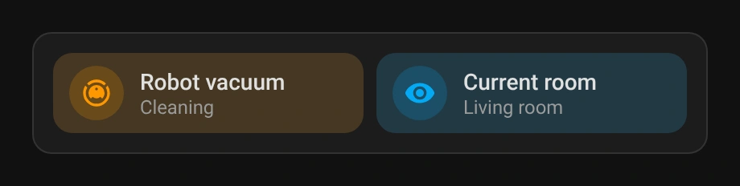

You pick the vacuum and the sensor that tells which room it is in. One **Show only if** rule looks at the vacuum, so both are shown while it is not docked. When it is docked, the card hides itself.

```yaml
type: custom:curio-card
layout: tiles
columns: 2
hide_when_empty: true
secondary_info:
  - state
entities:
  - vacuum.robot
  - sensor.robot_current_room
filter:
  only_if:
    - conditions:
        - entity: vacuum.robot
          field: state
          operator: is_not
          value: docked
```

**In the editor**

1. **Entities:** pick the vacuum and the room sensor.
2. **Filter → Add Show only if rule:** *Measure on* **Specific entities** with the vacuum, *State* **is not** `docked`.
3. **Appearance → Secondary information:** *State*.
4. **Advanced → Hide the card when empty:** on.

If the vacuum should always be on the card and only the room should follow it, use two rules. The first has *Domain* **is** `sensor` as well as the *Measure on* condition. The second is *Domain* **is** `vacuum`.

### Media players that are playing

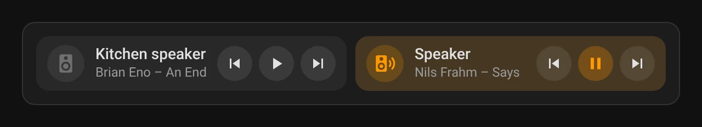

Only players that play or are paused, with the title as secondary information and playback buttons.

```yaml
type: custom:curio-card
layout: tiles
columns: 2
hide_when_empty: true
secondary_info:
  - media_title
controls:
  - media_prev
  - media_play_pause
  - media_next
filter:
  include:
    - conditions:
        - field: domain
          operator: is
          value: media_player
  only_if:
    - conditions:
        - field: state
          operator: in
          value: playing, paused
```

**In the editor**

1. **Filter → Add Include rule:** *Domain* **is** `media_player`.
2. **Filter → Add Show only if rule:** *State* **is one of** `playing, paused`.
3. **Appearance → Secondary information:** *Media player: artist and title*.
4. **Buttons → Controls:** *previous*, *play/pause* and *next*.

If a player should not have buttons at all (for example a Music Assistant player you control elsewhere), open it under **Customise per entity** and add the override **Hide all buttons**. This only works for players you pick by hand.

## Layout, grouping and colour

### A selector that only shows while a player is on

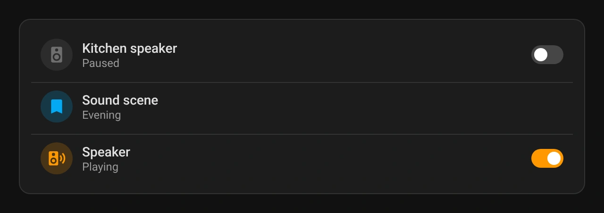

Show every media player that is playing or paused, and also an input select (here a sound scene), but only while at least one player is on. When nothing plays, the card hides itself.

```yaml
type: custom:curio-card
layout: list
hide_when_empty: true
secondary_info:
  - state
filter:
  include:
    - conditions:
        - field: domain
          operator: is
          value: media_player
    - conditions:
        - field: domain
          operator: is
          value: input_select
  only_if:
    - conditions:
        - field: state
          operator: in
          value: playing, paused, buffering
    - conditions:
        - field: domain
          operator: is
          value: input_select
        - entity: media_player.*
          match: any
          field: state
          operator: in
          value: playing, paused, buffering
```

**In the editor**

1. **Filter → Add Include rule:** *Domain* **is** `media_player`. Add a second rule: *Domain* **is** `input_select`.
2. **Filter → Add Show only if rule:** *State* **is one of** `playing, paused, buffering`.
3. **Add another Show only if rule:** *Domain* **is** `input_select`, then **Add condition**: *Measure on* **Pattern** `media_player.*`, *How many must match* **At least one**, *State* **is one of** `playing, paused, buffering`.
4. **Advanced → Hide the card when empty:** on.

Rules are OR with each other, so the players are shown by the first Show only rule, and the selector only by the second. To show the selector only when *all* players are on, or only when *none* is, change *How many must match*.

### Rooms with headings

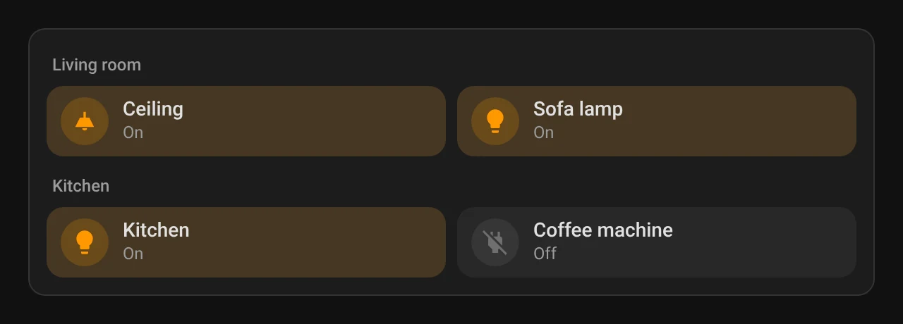

A manual card with your own headings and a divider. Good for a dashboard you set up once.

```yaml
type: custom:curio-card
layout: tiles
columns: 2
entities:
  - type: section
    label: Living room
  - entity: light.living_room
    name: Ceiling
    icon: mdi:ceiling-light
  - light.sofa_lamp
  - type: divider
  - type: section
    label: Kitchen
  - light.kitchen
  - switch.coffee_machine
```

**In the editor**

1. **Entities:** pick the entities.
2. **Customise per entity → Add section.** Move it to the top with the arrows, and call it *Living room*.
3. Add a divider and a second section for the kitchen, and move the entities under their headings.
4. Open the first light and fill in a **Name** and an **Icon**.

### Needs attention, sorted into groups

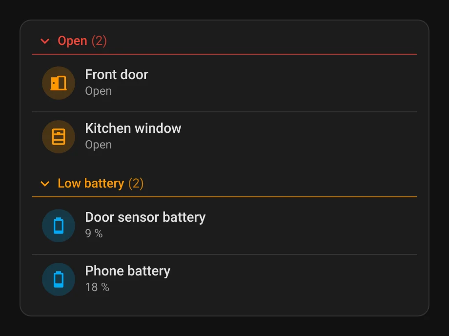

One card for everything that needs a look. Each group has its own colour, and what fits no group is hidden.

```yaml
type: custom:curio-card
layout: list
group_by: custom
group_style: line
group_rest_show: false
hide_when_empty: true
filter:
  include:
    - conditions:
        - field: device_class
          operator: in
          value: door, window, battery
group_rules:
  - name: Open
    color: red
    conditions:
      - field: device_class
        operator: in
        value: door, window
      - field: state
        operator: is
        value: "on"
  - name: Low battery
    color: orange
    conditions:
      - field: device_class
        operator: is
        value: battery
      - field: state
        operator: lt
        value: "20"
```

**In the editor**

1. **Filter → Add Include rule:** *Device class* **is one of** `door, window, battery`.
2. **Grouping → Group by:** Custom groups, **Heading style:** With line.
3. **Add group** *Open*, colour red, with the conditions *Device class* **is one of** `door, window` and *State* **is** `on`.
4. **Add group** *Low battery*, colour orange, with *Device class* **is** `battery` and *State* **is less than** `20`.
5. **Show the rest:** off.

### Grouped by state

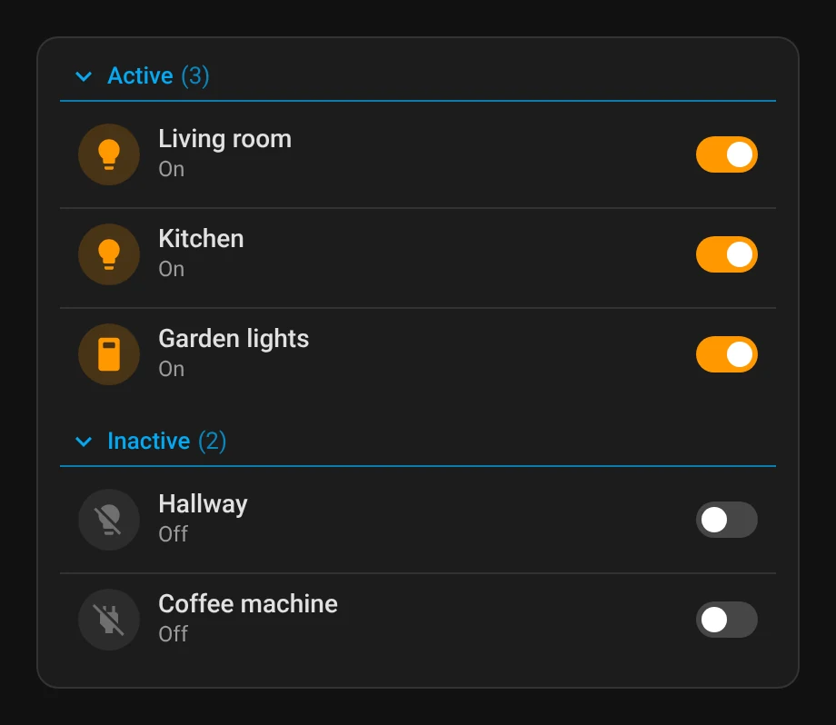

The entities are split into what is active and what is not, with a line under each heading.

```yaml
type: custom:curio-card
layout: list
group_by: state
group_style: line
group_color: primary
entities:
  - light.living_room
  - light.kitchen
  - light.hallway
  - switch.coffee_machine
  - switch.garden_lights
```

**In the editor**

1. **Layout → Layout:** List.
2. **Entities:** pick the entities.
3. **Grouping → Group by:** State. **Heading style:** With line. **Heading colour:** the primary colour.

### A keypad of scenes

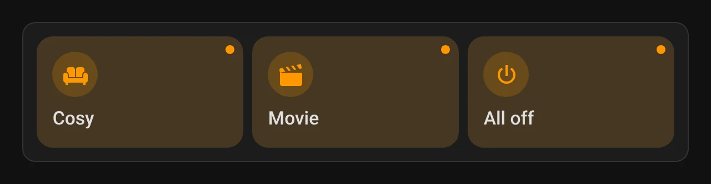

A grid where a tap runs a scene.

```yaml
type: custom:curio-card
layout: grid
columns: 3
size: l
secondary_info: []
entities:
  - scene.cosy
  - scene.movie
  - scene.all_off
```

**In the editor**

1. **Layout → Layout:** Grid, **Columns:** 3. **Appearance → Size:** L. **Secondary information:** None (a scene's state is only a time stamp).
2. **Entities:** pick the scenes. A tap on a scene runs it, because Toggle runs scenes and scripts.

### Big numbers

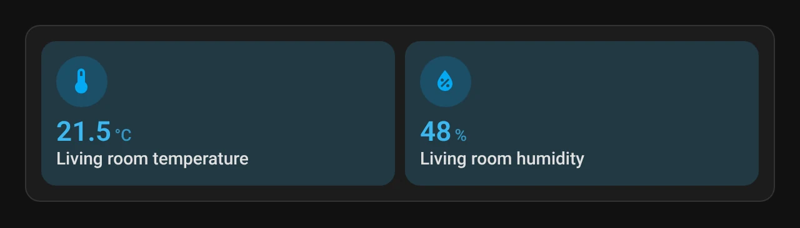

The icon on top and the value shown large, good for temperature and humidity.

```yaml
type: custom:curio-card
layout: tiles
columns: 2
icon_position: top
icon_size: l
big_value: true
secondary_info:
  - state
entities:
  - sensor.living_room_temperature
  - sensor.living_room_humidity
```

**In the editor**

1. **Layout → Layout:** Tiles, **Columns:** 2, **Icon position:** Top left.
2. **Appearance → Icon size:** L. **Big value:** on. **Secondary information:** *State*.
3. **Entities:** pick the sensors.

### IP addresses and other text values

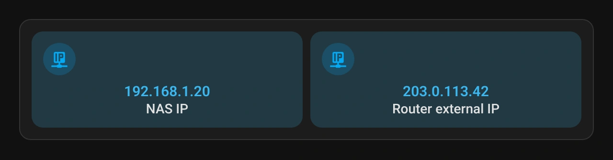

A filter finds every sensor whose entity ID ends in `ip`. The value is shown large and the text is centred. A text value such as an IP address is shown whole, and only a number followed by a unit is split into a large number and a small unit.

```yaml
type: custom:curio-card
layout: tiles
columns: 2
icon_position: top
big_value: true
text_align: center
secondary_info:
  - state
filter:
  include:
    - conditions:
        - field: entity_id
          operator: is
          value: sensor.*ip
```

**In the editor**

1. **Layout → Layout:** Tiles, **Columns:** 2, **Icon position:** Top left, **Text alignment:** Centre.
2. **Appearance → Big value:** on. **Secondary information:** *State*.
3. **Filter → Add Include rule:** *Entity ID* **is** `sensor.*ip`.

### Chips with notification bubbles

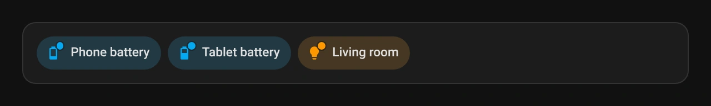

Small chips where the icon wears a bubble, like a notification.

```yaml
type: custom:curio-card
layout: chips
size: s
indicator: bubble
indicator_position: top_right
entities:
  - sensor.phone_battery
  - sensor.tablet_battery
  - light.living_room
```

**In the editor**

1. **Layout → Layout:** Chips. **Appearance → Size:** S.
2. **Status indicators → Status indicator:** Notification bubble. **Position:** Top right.
3. **Entities:** pick the entities.

In chips of size XS and S the bubble is always a dot. Turn on **Bubble shows the text** on a larger size to see values in it.

### A different colour rule for one entity

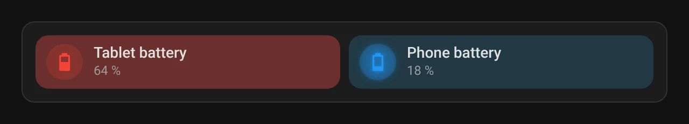

The card has one rule for every item, but the phone has a rule of its own. A rule on an entity is checked first, so it wins over the card's rule.

```yaml
type: custom:curio-card
layout: tiles
columns: 2
color_rules:
  - conditions:
      - field: state
        operator: lt
        value: "70"
    color: red
    animation: pulse
entities:
  - sensor.tablet_battery
  - entity: sensor.phone_battery
    color_rules:
      - conditions:
          - field: state
            operator: lt
            value: "70"
        color: blue
        animation: glow
        affects: icon
```

**In the editor**

1. **Colours and animation → Add rule:** *State* **is less than** `70`, **Colour** red, **Animation** Pulse.
2. **Entities → Customise per entity**, open the phone, and find **Colour rules for this entity**. **Add rule:** *State* **is less than** `70`, **Colour** blue, **Affects** Icon only, **Animation** Glow.

### Signal and power from the device's sensors

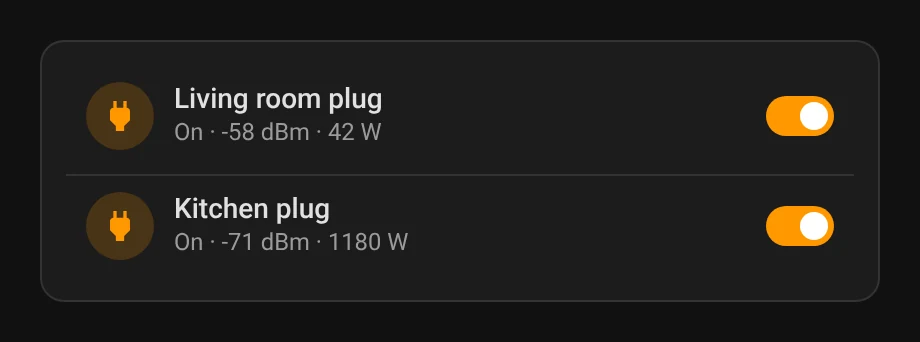

A plug's power and signal strength are separate sensors on the same device. Secondary information finds them for you.

```yaml
type: custom:curio-card
layout: list
secondary_info:
  - state
  - dev_power
  - dev_signal
entities:
  - switch.plug_living_room
  - switch.plug_kitchen
```

**In the editor**

1. **Entities:** pick the plugs.
2. **Appearance → Secondary information:** *State*, *Device's sensor: power* and *Device's sensor: signal*.

The information is shown in the fixed order of the list in the editor, not in the order you pick it.

## Controls

### Lights with brightness and a scene button

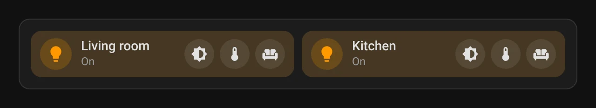

Each light gets a brightness slider and a colour temperature slider, and a button that runs a scene.

```yaml
type: custom:curio-card
layout: tiles
columns: 2
controls:
  - brightness
  - kelvin
buttons:
  - icon: mdi:sofa
    name: Cosy
    tap_action:
      action: perform-action
      perform_action: scene.turn_on
      target:
        entity_id: scene.cosy
entities:
  - light.living_room
  - light.kitchen
```

**In the editor**

1. **Entities:** pick the lights.
2. **Buttons → Controls:** *Light: brightness* and *Light: Kelvin*.
3. **Buttons → Add button:** Icon `mdi:sofa`, Tooltip *Cosy*. Under **Tap** choose *Perform action*, pick `scene.turn_on` and the scene as target.

A light with no colour temperature support shows only the brightness slider.

### Buttons in your own place and order

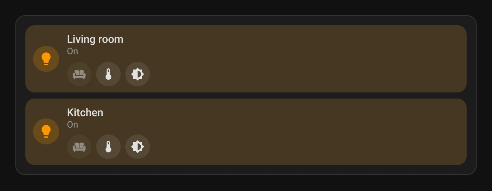

The row of buttons sits below the text, and your own scene button comes before the two sliders.

```yaml
type: custom:curio-card
layout: tiles
columns: 1
controls:
  - brightness
  - kelvin
buttons_position: below
buttons_order:
  - btn:0
  - kelvin
  - brightness
buttons:
  - icon: mdi:sofa
    name: Cosy
    tap_action:
      action: perform-action
      perform_action: scene.turn_on
      target:
        entity_id: scene.cosy
entities:
  - light.living_room
  - light.kitchen
```

**In the editor**

1. **Entities:** pick the lights. **Buttons → Controls:** *Light: brightness* and *Light: Kelvin*. **Add button** with the scene, as in the recipe above.
2. **Buttons → Button placement:** Below the text.
3. **Order of the buttons:** use **↑** and **↓** to put *Cosy* first, then *Kelvin*, then *Brightness*.

The order is also available for one entity under **Customise per entity**. See [Controls and buttons](controls-and-buttons.md#where-the-buttons-sit-and-in-what-order).

### Blinds and a fan

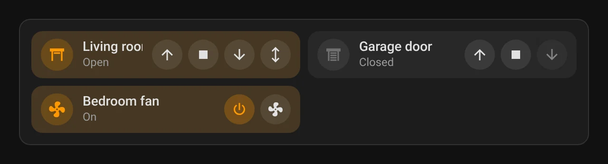

Open, stop and close buttons for covers, a position slider, and a power button and speed slider for the fan. Each entity shows only the controls it supports.

```yaml
type: custom:curio-card
layout: tiles
columns: 2
controls:
  - cover_open
  - cover_stop
  - cover_close
  - cover_position
  - fan_toggle
  - fan_speed
entities:
  - cover.living_room_blinds
  - cover.garage
  - fan.bedroom
```

**In the editor**

1. **Entities:** pick the covers and the fan.
2. **Buttons → Controls:** *Cover: open*, *stop*, *close*, *position (slider)*, *Fan: turn on/off* and *speed (slider)*.

### A lock, a number and a choice list

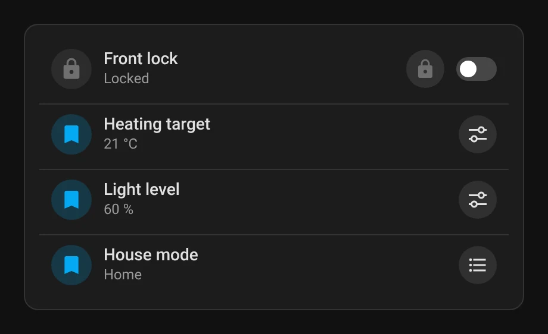

One list with a lock, two number sliders and a choice list. Tapping a slider or list button unfolds it inside the item.

```yaml
type: custom:curio-card
layout: list
controls:
  - lock_toggle
  - number_slider
  - select_option
entities:
  - lock.front_door
  - number.heat_target
  - input_number.light_level
  - select.house_mode
```

**In the editor**

1. **Layout → Layout:** List. **Entities:** pick the entities.
2. **Buttons → Controls:** *Lock: lock/unlock*, *Number: slider* and *Choice: list*.

A locked lock needs two presses to unlock.

### Thermostats

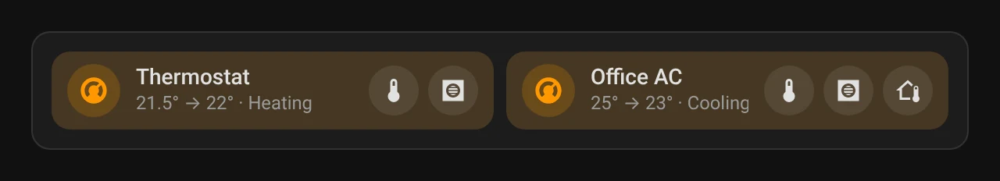

The current and the wanted temperature as text, and controls for the target, the mode and the preset.

```yaml
type: custom:curio-card
layout: tiles
columns: 2
secondary_info:
  - climate_temps
  - climate_action
controls:
  - climate_target
  - climate_mode
  - climate_preset
entities:
  - climate.living_room
  - climate.office
```

**In the editor**

1. **Entities:** pick the climate entities.
2. **Appearance → Secondary information:** *Climate: current → target* and *Climate: what it is doing now*.
3. **Buttons → Controls:** *Climate: target temperature (slider)*, *HVAC mode (list)* and *preset (list)*.

### A robot vacuum

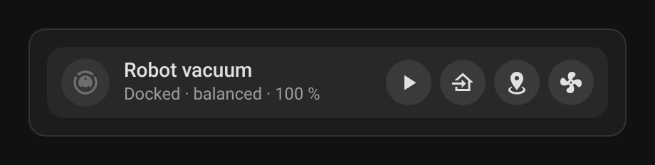

Suction power and battery as text, and buttons to start or pause, return to the dock, locate the vacuum and choose the suction power.

```yaml
type: custom:curio-card
layout: tiles
secondary_info:
  - state
  - vacuum_fan
  - battery
controls:
  - vacuum_start_pause
  - vacuum_return
  - vacuum_locate
  - vacuum_fan_speed
entities:
  - vacuum.robot
```

**In the editor**

1. **Entities:** pick the vacuum.
2. **Appearance → Secondary information:** *State*, *Vacuum: suction power* and *Battery*.
3. **Buttons → Controls:** *Vacuum: start/pause*, *return to dock*, *locate* and *suction power (list)*.

If your vacuum supports it and its rooms are set up in Home Assistant, add *Vacuum: clean by area* to the controls.

### A fan with the device's own choices


Many devices have extra settings as their own `select` and `number` entities, for example a fan's horizontal and vertical swing. With **The device's own choices, numbers and buttons** they appear as controls on the fan itself.

```yaml
type: custom:curio-card
layout: tiles
columns: 1
controls:
  - fan_toggle
  - fan_speed
device_controls: true
entities:
  - fan.whisper_flex
```

**In the editor**

1. **Entities:** pick the fan.
2. **Buttons → Controls:** *Fan: turn on/off* and *Fan: speed (slider)*.
3. **Buttons → The device's own choices, numbers and buttons:** on.

This is not shown in chips.
