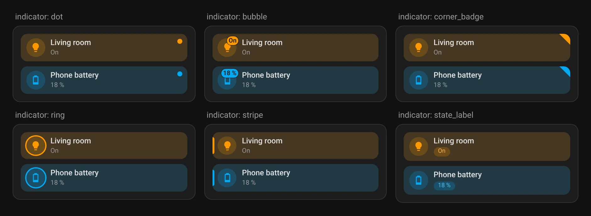
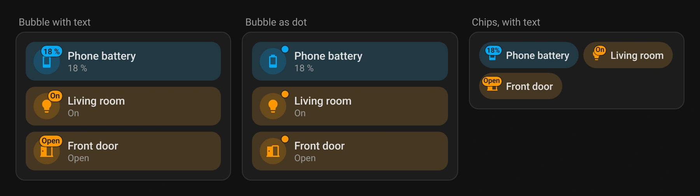

# Status indicators

A status indicator is a small marker on the item that shows its state at a glance. It is in the **Status indicators** section.



## Indicators

| Choice | What it looks like |
|---|---|
| **None** | No indicator. This is the default, except in the grid |
| **Dot** | A small dot in a corner. Default in the grid |
| **Corner badge** | A small triangle in a corner |
| **Ring** | A ring around the icon |
| **Stripe** | A thin stripe along the left edge of the item. In chips it sits along the bottom |
| **Notification bubble** | A bubble on the icon, like a notification. A dot, or with text |
| **State text** | The state written out, for example "On", under the name |

An indicator uses the colour of the item, so it follows the state colours and your [colour rules](colour-rules.md). A rule can colour the indicator alone with *Affects → Indicator only*.

## Settings

| Setting | What it does |
|---|---|
| **Status indicator** | Which indicator to show |
| **Bubble shows the text** | With a notification bubble: shows the state or value as text, for example "On" or "85 %". When off, the bubble is a small dot. In chips of size XS and S the bubble is always a dot |
| **Position** | Where the marker sits: Top right, Top left, Bottom right or Bottom left. Used by Dot, Corner badge and Notification bubble |



### State text

State text is placed under the name. If the secondary information also shows the state, it is only shown once.

### Chips

Indicators work in every layout. In chips, a dot and a bubble are fastened to the icon so they are never cut off by the round end of the chip or hide the text.

## Per entity

A single entity can have its own indicator, bubble text and position. See [Entities](entities.md#override-card-settings).

## In YAML

```yaml
type: custom:curio-card
indicator: bubble
bubble_text: true
indicator_position: top_left
```
